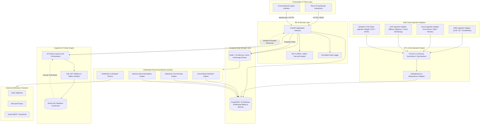

# CloudSage – Multi-Cloud FinOps Copilot

[](LICENSE)
[](docs/FUNCTIONAL_REQUIREMENTS.md)
[](docs/BUSINESS_REQUIREMENTS.md)
[](docs/DEVELOPMENT_ROADMAP.md)

> **CloudSage** is an enterprise-grade, AI-powered Multi-Cloud Financial Operations (FinOps) platform engineered to unify fragmented cloud billing data, detect unnecessary expenditure, identify cost anomalies, and generate prioritized, evidence-backed savings recommendations across **Amazon Web Services (AWS)**, **Microsoft Azure**, and **Google Cloud Platform (GCP)**.

---

## 1. Problem Statement

As modern enterprises scale digital infrastructure across heterogeneous cloud ecosystems, cloud expenditures have rapidly grown into one of the largest operating expenses. However, decentralized engineering practices cause severe financial leakages:

1. **Fragmented Billing Data**: Incompatible billing formats (AWS CUR, Azure Cost Export, GCP BigQuery Export) prevent unified financial reporting and cost visibility.
2. **Unnecessary Spending**: Idle virtual machines and oversized compute instances silently inflate monthly invoices.
3. **Forgotten & Abandoned Infrastructure**: Unattached storage disks (EBS, Managed Disks, Persistent Disks), orphaned backup snapshots, and unused static IPs drain budgets without delivering business value.
4. **Delayed Anomaly Detection**: Unanticipated spending surges are often discovered weeks later during monthly invoice reconciliation.
5. **Deficient Tagging & Ownership**: Missing or inconsistent tags obscure departmental accountability, preventing accurate chargeback and showback.
6. **Information Asymmetry**: Non-technical financial and executive stakeholders struggle to extract actionable insights from complex cloud billing consoles.

---

## 2. Project Objectives

CloudSage bridges the gap between infrastructure engineering, financial operations, and executive leadership by delivering:

- **Single Source of Truth**: Automated ingestion and canonical normalization of multi-cloud billing feeds into the open **FOCUS™ 1.0** standard.
- **Continuous Waste Detection**: Algorithmic heuristics detecting idle, oversized, unattached, and orphaned cloud resources.
- **Near Real-Time Anomaly Detection**: Statistical baselining flagging cost spikes within minutes of ingestion with root-cause attribution.
- **Strictly Advisory Recommendations**: Prioritized savings proposals with transparent mathematical proof and risk classifications. **CloudSage enforces a strict non-destructive policy with zero autonomous deletion or downsizing.**
- **Conversational AI FinOps Copilot**: Natural language query interface grounded strictly in deterministic database calculations—ensuring zero fabricated figures.

---

## 3. Core Features

| Feature Domain | Capabilities |
| :--- | :--- |
| **Multi-Cloud Ingestion** | Scheduled, idempotent ingestion of AWS Cost & Usage Reports (CUR), Azure Cost Management exports, GCP Cloud Billing exports, and local synthetic seed datasets. |
| **Unified Normalization** | Full compliance with FinOps Open Cost & Usage Specification (FOCUS™ 1.0), currency conversion to USD, service taxonomy classification, and tag sanitization. |
| **Cloud Waste Engine** | Automated scanning for idle VMs (CPU < 5%), oversized instances (CPU < 15%), unattached storage disks, orphaned snapshots, idle static IPs, and 24x7 non-production environments. |
| **Cost Anomaly Engine** | 30-day rolling statistical baselines, Z-score ($\ge 3.0$) and IQR outlier detection, structural change-point detection, and instant multi-channel alert dispatch. |
| **Advisory Recommendation Engine** | Actionable remediation proposals with estimated monthly/annualized savings, risk ratings (`NONE`, `LOW`, `MEDIUM`, `HIGH`), priority scoring ($P1$ to $P4$), and human approval lifecycles. |
| **AI FinOps Copilot** | Natural language queries translated into schema-safe, read-only SQL queries with AST validation, returning deterministic figures and tabular proofs. |
| **Executive Dashboard** | High-performance React dashboard showing MTD spend, run-rate projections, provider breakdowns, daily/monthly spend trends, and tagging compliance gauges. |
| **Alerts & Notification Hub** | Configurable budget thresholds and anomaly alerts dispatched via Slack webhooks, Microsoft Teams, and Email. |
| **Enterprise RBAC & Audit** | 5 core persona roles (Super Admin, FinOps Engineer, Finance Analyst, Engineering Manager, Executive) with ABAC team scoping and an immutable audit ledger. |

---

## 4. High-Level System Architecture



---

## 5. Technology Stack Summary

- **Frontend**: React 18, TypeScript, Tailwind CSS, Recharts, Lucide Icons, TanStack Table.
- **Backend API**: Python 3.11+, FastAPI (async), Pydantic v2, SQLAlchemy 2.0 (asyncpg).
- **Database**: PostgreSQL 16+ with Native Declarative Range Partitioning by billing period and GIN/B-tree indexing.
- **Data Processing**: Python 3.11, Pandas (chunked streaming), DuckDB / Polars evaluation.
- **Background Processing**: Celery 5.3+, Redis 7+ (broker, results backend, and metrics cache).
- **AI & Copilot**: LLM Orchestration with Schema-Constrained Tool Calling (NL2SQL), Abstract Syntax Tree (AST) query safety validation, and read-only connection sandboxing.
- **Cloud Integrations**: AWS SDK (boto3), Azure SDK, Google Cloud Client Libraries (read-only IAM roles).
- **DevOps & Infrastructure**: Docker (multi-stage builds), Docker Compose, GitHub Actions CI/CD workflows.
- **Observability**: Prometheus metrics exporter, Grafana dashboards, structured JSON logging.

---

## 6. 15-Stage Development Roadmap

The development of CloudSage is structured across 15 disciplined stages:

| Stage | Name | Status | Key Deliverable |
| :---: | :--- | :---: | :--- |
| **01** | **Requirement Analysis & Project Foundation** | **Completed** | Requirements, Architecture, Governance & Roadmap Foundation |
| **02** | **Core Data Models & Database Schema Architecture** | **Completed** | FOCUS 1.0 PostgreSQL schemas, partitioning, and Alembic migrations |
| **03** | **Multi-Cloud Ingestion Engine** | **Completed** | AWS CUR, Azure Cost, GCP BigQuery adapters, deduplication & REST API |
| **04** | **Unified Data Normalization & FOCUS Pipeline** | **Completed** | FOCUS 1.0 validation, historical FX, SKU catalog, tag governance & quality engine |
| **05** | **Multi-Cloud Resource Discovery & Inventory Intelligence** | **Completed** | Multi-cloud adapters, directional topology graph, reconciliation & quality scoring |
| **06** | **Cloud Waste Detection Engine** | **Completed** | Heuristics for idle VMs, oversized compute, unattached disks & snapshots |
| **07** | **Cost Anomaly Detection Engine** | **Completed** | Statistical baselining, Z-score/IQR ensemble, change-point analysis & root cause |
| **08** | Advisory Recommendation Engine & Optimization | *Planned* | Priority scoring, risk rating, savings calculation & approval states |
| **09** | Core REST API & Backend Service Layer | *Planned* | FastAPI REST endpoints, filtering, cursor pagination & export APIs |
| **10** | AI FinOps Copilot & Grounded Query Engine | *Planned* | Schema-safe NL2SQL translator, AST sandbox & deterministic verifier |
| **11** | Enterprise Frontend Dashboard & Visualization UI | *Planned* | React/TypeScript UI, KPI cards, Recharts trends & provider breakdowns |
| **12** | Waste & Recommendation Management UI | *Planned* | Interactive review tables, approval actions & remediation guides |
| **13** | Anomaly Detection & Alerts Notification Hub | *Planned* | Threat feed, alert threshold rules & Slack/Teams/Email dispatchers |
| **14** | Role-Based Access Control (RBAC) & Audit Logging | *Planned* | JWT auth, role middleware, ABAC scoping & immutable audit logging |
| **15** | Production Containerization, CI/CD & Readiness | *Planned* | Multi-stage Docker, Compose, GitHub Actions & Prometheus/Grafana |

---

## 7. Current Development Status

- **Completed Stages**: 
  - Stage 1: Requirement Analysis & Project Foundation (`stage-1/project-foundation`).
  - Stage 2: Core Data Models & Database Schema Architecture (`stage-2/data-models-schema`).
  - Stage 3: Multi-Cloud Ingestion Engine (`stage-3/multicloud-ingestion`).
  - Stage 4: Unified Data Normalization & FOCUS Pipeline (`stage-4/focus-normalization`).
  - Stage 5: Multi-Cloud Resource Discovery & Inventory Intelligence (`stage-5/resource-inventory`).
  - Stage 6: Cloud Waste Detection Engine (`stage-6/waste-detection`).
  - Stage 7: Intelligent Multi-Cloud Cost Anomaly Detection Engine (`stage-7/cost-anomaly-detection`).
  - Stage 8: Advisory FinOps Recommendation & Optimization Engine (`stage-8/recommendation-engine`).
- **Active Branch**: `stage-8/recommendation-engine`.
- **Next Milestone**: Stage 9 (AI FinOps Copilot – Natural Language Query & Reasoning Engine) awaits formal review and approval.

---

## 8. Multi-Cloud Recommendation & Ingestion Quickstart

### Recommendation Engine REST API Quickstart
```bash
# Start FastAPI application
uvicorn backend.app.main:app --host 0.0.0.0 --port 8000

# 1. Trigger Multi-Cloud Recommendation Run
curl -X POST "http://localhost:8000/api/v1/recommendations/run" \
  -H "Content-Type: application/json" \
  -d '{"provider": "ALL", "scope": "FULL"}'

# 2. Retrieve Executive Recommendation Summary
curl "http://localhost:8000/api/v1/recommendations/summary"

# 3. Query Priority P1 Recommendations
curl "http://localhost:8000/api/v1/recommendations?priority=P1&limit=10"

# 4. Inspect Recommendation Evidence & Guidance
curl "http://localhost:8000/api/v1/recommendations/{recommendation_id}"

# 5. Execute Formal Lifecycle Approval
curl -X PATCH "http://localhost:8000/api/v1/recommendations/{recommendation_id}/status" \
  -H "Content-Type: application/json" \
  -d '{"status": "APPROVED", "actor_email": "finops-lead@enterprise.com", "notes": "Approved for sprint maintenance"}'

# 6. Export Recommendations in CSV or JSON
curl "http://localhost:8000/api/v1/recommendations/export?export_format=csv" -o recommendations.csv
```

### Ingestion & Normalization REST API Quickstart
```bash
# Start the FastAPI application
uvicorn backend.app.main:app --host 0.0.0.0 --port 8000

# 1. Ingest Multi-Cloud Billing Feeds
curl -X POST "http://localhost:8000/api/v1/ingestion/upload/aws" \
  -F "file=@backend/sample_data/aws/aws_cur_sample.csv"

# 2. Trigger Batch Normalization / In-Place Reprocessing
curl -X POST "http://localhost:8000/api/v1/normalization/run" \
  -H "Content-Type: application/json" \
  -d '{"provider": "AWS", "reprocess_all": true, "batch_size": 500}'

# 3. Retrieve Latest Data Quality Assessment
curl "http://localhost:8000/api/v1/normalization/quality-report"

# 4. Check FOCUS 1.0 Conformance Assessment
curl "http://localhost:8000/api/v1/normalization/focus-validation"

# 5. Query Tag Hygiene Scores
curl "http://localhost:8000/api/v1/normalization/tag-quality?limit=10"
```

### Waste Detection REST API Quickstart
```bash
# 1. Trigger Multi-Cloud Waste Detection Run
curl -X POST "http://localhost:8000/api/v1/waste-detection/run" \
  -H "Content-Type: application/json" \
  -d '{"provider": "ALL", "lookback_days": 7}'

# 2. Query High-Severity Waste Findings
curl "http://localhost:8000/api/v1/waste-detection/findings?severity=HIGH&limit=10"

# 3. Retrieve Executive Waste Summary
curl "http://localhost:8000/api/v1/waste-detection/summary"

# 4. Detailed Financial Savings Summary
curl "http://localhost:8000/api/v1/waste-detection/savings-summary"

# 5. Inspect Finding Evidence Proof
curl "http://localhost:8000/api/v1/waste-detection/findings/{finding_id}/evidence"

# 6. Human Review: Acknowledge or Dismiss Finding
curl -X PATCH "http://localhost:8000/api/v1/waste-detection/findings/{finding_id}/status" \
  -H "Content-Type: application/json" \
  -d '{"status": "ACKNOWLEDGED", "user": "finops@company.com"}'
```

### Running Test Suites
```bash
python3 -m pytest backend/tests -v
```

---

## 9. Documentation Index

Detailed architectural and functional specifications are located in the [`docs/`](docs/) directory:

- [Project Overview & Executive Summary](docs/PROJECT_OVERVIEW.md)
- [Business Requirements Document (BRD)](docs/BUSINESS_REQUIREMENTS.md)
- [Functional Requirements Document (FRD)](docs/FUNCTIONAL_REQUIREMENTS.md)
- [Non-Functional Requirements Document (NFR)](docs/NON_FUNCTIONAL_REQUIREMENTS.md)
- [Database Schema & Relational Data Architecture](docs/DATABASE_SCHEMA.md)
- [Multi-Cloud Ingestion Engine Architecture](docs/INGESTION_ARCHITECTURE.md)
- [Cloud Provider Field Mappings & Normalization Taxonomy](docs/CLOUD_PROVIDER_FIELD_MAPPINGS.md)
- [FOCUS 1.0 Specification Conformance & Matrix](docs/FOCUS_1_0_IMPLEMENTATION.md)
- [Advanced Currency Normalization & Historical FX](docs/CURRENCY_NORMALIZATION.md)
- [Multi-Cloud SKU Catalog & Taxonomy](docs/SKU_CATALOG.md)
- [Advanced Resource Tag Normalization & Hygiene](docs/TAG_NORMALIZATION.md)
- [Data Quality & Governance Framework](docs/DATA_QUALITY_FRAMEWORK.md)
- [Unified Normalization Pipeline Architecture](docs/NORMALIZATION_PIPELINE.md)
- [Data Normalization & FOCUS 1.0 Alignment](docs/DATA_NORMALIZATION.md)
- [Synthetic Datasets & Seeded FinOps Scenarios](docs/SYNTHETIC_DATASETS.md)
- [Multi-Cloud Ingestion API Reference](docs/INGESTION_API.md)
- [User Roles, Personas & Permissions Matrix](docs/USER_ROLES_AND_PERMISSIONS.md)
- [Technology Stack Evaluation](docs/TECHNOLOGY_STACK.md)
- [System Architecture & Data Flow](docs/SYSTEM_ARCHITECTURE.md)
- [Acceptance & Success Criteria](docs/SUCCESS_CRITERIA.md)
- [Multi-Cloud Resource Inventory & Intelligence Architecture](docs/RESOURCE_INVENTORY_ARCHITECTURE.md)
- [Cloud Provider Inventory Adapters Reference](docs/CLOUD_PROVIDER_ADAPTERS.md)
- [Multi-Cloud Resource Reconciliation Engine](docs/RESOURCE_RECONCILIATION.md)
- [Multi-Cloud Resource Topology & Relationships](docs/RESOURCE_RELATIONSHIPS.md)
- [Billing-to-Inventory Financial Correlation](docs/BILLING_INVENTORY_CORRELATION.md)
- [Inventory Quality & Governance Evaluation Framework](docs/INVENTORY_QUALITY.md)
- [Resource Inventory & Intelligence REST API Reference](docs/INVENTORY_API.md)
- [Multi-Cloud Waste Detection Architecture](docs/WASTE_DETECTION_ARCHITECTURE.md)
- [Waste Detection Rules & Heuristics Catalog](docs/DETECTION_RULES.md)
- [Idle Compute Detection Specification](docs/IDLE_COMPUTE_DETECTION.md)
- [Storage & Snapshot Waste Detection Specification](docs/STORAGE_AND_SNAPSHOT_DETECTION.md)
- [Oversized Resource Detection & Rightsizing Specification](docs/OVERSIZED_RESOURCE_DETECTION.md)
- [Conservative Financial Savings Estimation Methodology](docs/SAVINGS_ESTIMATION.md)
- [Waste Finding Lifecycle & Governance Specification](docs/FINDING_LIFECYCLE.md)
- [Multi-Cloud Waste Detection REST API Reference](docs/WASTE_DETECTION_API.md)
- [Synthetic Waste Test Scenarios Matrix](docs/DETECTION_TEST_SCENARIOS.md)
- [Cost Anomaly Detection Engine Architecture](docs/COST_ANOMALY_DETECTION_ARCHITECTURE.md)
- [Statistical Methods & Anomaly Algorithms](docs/STATISTICAL_METHODS.md)
- [Baseline Calculation & Metric Models](docs/BASELINE_CALCULATION.md)
- [Root Cause Attribution Engine](docs/ROOT_CAUSE_ATTRIBUTION.md)
- [Financial Impact Assessment Methodology](docs/FINANCIAL_IMPACT_ASSESSMENT.md)
- [Anomaly Lifecycle & Governance Specification](docs/ANOMALY_LIFECYCLE.md)
- [Cost Anomaly Detection REST API Reference](docs/ANOMALY_DETECTION_API.md)
- [Synthetic Anomaly Scenarios Catalog](docs/SYNTHETIC_ANOMALY_SCENARIOS.md)
- [Recommendation Engine Architecture](docs/RECOMMENDATION_ENGINE_ARCHITECTURE.md)
- [Optimization Strategies Catalog](docs/RECOMMENDATION_STRATEGIES.md)
- [Prioritization & Multi-Factor Scoring](docs/RECOMMENDATION_SCORING.md)
- [Financial Savings Calculation Engine](docs/SAVINGS_CALCULATION.md)
- [Recommendation Correlation & Anti-Double-Counting](docs/RECOMMENDATION_CORRELATION.md)
- [Recommendation Lifecycle & Governance](docs/RECOMMENDATION_LIFECYCLE.md)
- [Recommendation REST API Reference](docs/RECOMMENDATION_API.md)
- [Recommendation Security & Non-Destructive Advisory Policy](docs/RECOMMENDATION_SECURITY.md)
- [Synthetic Recommendation Scenarios Catalog](docs/SYNTHETIC_RECOMMENDATION_SCENARIOS.md)
- [Stage 8 QA Test and Verification Report](docs/STAGE_8_TEST_REPORT.md)
- [15-Stage Enterprise Development Roadmap](docs/DEVELOPMENT_ROADMAP.md)

---

## 10. Non-Destructive Advisory Policy

> [!IMPORTANT]
> **Advisory-Only Safety Guarantee**: CloudSage does **not** perform autonomous destructive changes to cloud infrastructure. All recommendations generated by the platform are strictly advisory. Infrastructure modifications require human review, engineering approval, and manual or CI/CD execution via external infrastructure-as-code tools (Terraform, CloudFormation, Pulumi, or cloud consoles).
