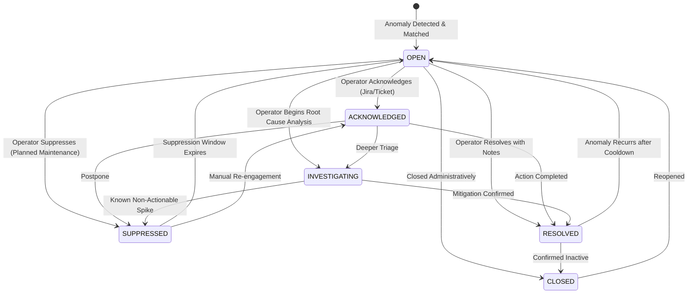

# CloudSage Alert Lifecycle & Deduplication Architecture

## 1. Overview

To prevent alert fatigue while ensuring critical financial incidents receive prompt attention, CloudSage implements an intelligent alert lifecycle and deduplication architecture. The engine guarantees deterministic identity computation, cooldown window suppression, severity escalation bypasses, and an audited state machine.

---

## 2. Deterministic Deduplication Key Algorithm

Every incoming cost anomaly is assigned a deterministic deduplication key (`dedup_key`) based on its attribution dimensions and the triggering rule:

### Formulation:
1. **Resource-Level Anomalies**:
   ```
   res:{provider}:{resource_id}:{rule_id}
   ```
   *Example*: `res:AWS:i-0192837482910abcdef:f47ac10b-58cc-4372-a567-0e02b2c3d479`

2. **Service / Account-Level Anomalies**:
   ```
   acct:{provider}:{account_id}:{service_name}:{region}:{rule_id}
   ```
   *Example*: `acct:AWS:111222333444:Amazon EC2:us-east-1:f47ac10b-58cc-4372-a567-0e02b2c3d479`

### Deduplication Guarantee:
When an anomaly with an existing `dedup_key` is processed:
- The system locates the active `AlertInstance` corresponding to the key.
- It increments `trigger_count += 1` on the existing instance.
- It updates `last_triggered_at = now()`.
- It evaluates whether the event is within the cooldown window or qualifies for severity escalation.

---

## 3. Cooldown Windows & Severity Escalation

```
[Duplicate Anomaly Arrives]
            │
            ▼
    Is within Cooldown?
            ├── No ──────────> Re-open Alert (if resolved) & Enqueue Notification
            └── Yes
                  │
                  ▼
         Severity Escalated? (e.g. HIGH -> CRITICAL)
                  ├── Yes ───> Bypass Cooldown: Increment escalation_level,
                  │             Record ESCALATE Audit, Enqueue Immediate Outbox
                  └── No ────> Suppress Outbox: Increment trigger_count only
```

### 1. Cooldown Suppression:
- If `(now - last_triggered_at) < rule.cooldown_minutes`, duplicate notifications are suppressed.
- `trigger_count` increments, providing visibility into the persistent frequency of the spike without spamming operators.

### 2. Severity Escalation Bypass:
- If a recurring anomaly escalates in severity tier (e.g. `MEDIUM` $\rightarrow$ `CRITICAL`, or excess cost doubles beyond threshold), the cooldown is bypassed.
- An immutable `AlertHistory` entry is recorded with action `ESCALATE`.
- A high-priority outbox notification is immediately enqueued with `is_escalation=True`.

---

## 4. Alert Lifecycle State Machine

Alert instances progress through 6 formal lifecycle states:



### Transition Table & Rules:

| Origin Status | Allowed Next Statuses | Prerequisites & Governance |
| :--- | :--- | :--- |
| `OPEN` | `ACKNOWLEDGED`, `INVESTIGATING`, `RESOLVED`, `SUPPRESSED`, `CLOSED` | Default initial state upon creation. |
| `ACKNOWLEDGED` | `INVESTIGATING`, `RESOLVED`, `SUPPRESSED`, `CLOSED` | Captures `acknowledged_by`, timestamp, and ticket reference (`FIN-xxxx`). |
| `INVESTIGATING` | `RESOLVED`, `SUPPRESSED`, `CLOSED` | Captures investigation notes and root cause observations. |
| `RESOLVED` | `OPEN`, `CLOSED` | **Mandatory Resolution Notes**: Attempting to resolve without notes raises `ResolutionNoteRequiredError`. |
| `SUPPRESSED` | `OPEN`, `ACKNOWLEDGED` | Requires documented reason and duration (`suppress_hours`, default 24h). |
| `CLOSED` | `OPEN` | Final terminal or archived state. |

---

## 5. Audit History Ledger

Every lifecycle mutation generates an immutable record in `alert_history`:
- `alert_instance_id`: Linked alert instance.
- `from_status`: Status prior to mutation.
- `to_status`: New status following mutation.
- `actor`: Server-derived authenticated user email or system principal.
- `action`: `CREATE`, `ACKNOWLEDGE`, `INVESTIGATE`, `RESOLVE`, `SUPPRESS`, `ESCALATE`, `REOPEN`, `CLOSE`.
- `notes`: Documented operator justification or RCA commentary.
- `created_at`: UTC timestamp.
