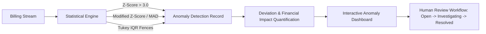

# Cost Anomaly Detection Dashboard

## 1. Overview

The Cost Anomaly Detection Dashboard provides continuous observability into unexpected spending surges, abnormal step increases, and unbudgeted cloud expenditure across AWS, Microsoft Azure, and GCP.

It translates the statistical detections from Stage 7 into an actionable incident command interface where engineering owners and FinOps teams can review, acknowledge, investigate, and resolve anomalous cost spikes.

---

## 2. Statistical Anomaly Architecture

---

## 3. Severity Classification & Thresholds

Anomalies are categorized into 4 standardized severity tiers based on statistical deviation score ($Z$) and absolute dollar impact:

| Severity | Z-Score Threshold | Minimum Financial Impact | UI Visual Cue | Required SLA |
|---|---|---|---|---|
| **CRITICAL** | $Z \ge 4.0$ or Spike $> +100\%$ | $\ge \$50.00$ excess | Rose badge / pulse alert | 4 hours response |
| **HIGH** | $3.0 \le Z < 4.0$ | $\ge \$20.00$ excess | Amber badge | 24 hours response |
| **MEDIUM** | $2.0 \le Z < 3.0$ | $\ge \$10.00$ excess | Blue badge | 3 business days |
| **LOW** | $1.5 \le Z < 2.0$ | $<\$10.00$ excess | Slate badge | Informational |

---

## 4. Key Metrics & Incident Exploration

1. **Total Active Anomalies**: Current unresolved spike incidents requiring attention.
2. **Total Excess Financial Impact**: Sum of excess expenditure incurred above expected baselines ($$\text{Actual Cost} - \text{Expected Cost}$$).
3. **Distribution by Provider**: Concentration of anomalies across AWS, Azure, and GCP.
4. **Distribution by Service**: Highlights repeat offender services (e.g., S3 API call surges, NAT Gateway egress bursts).
5. **Incident Table Columns**:
   - `Detected Date`: Calendar date of anomaly spike.
   - `Provider & Account`: Cloud hyperscaler and account/subscription/project ID.
   - `Service Name & Category`: Target service (Compute, Storage, Database, Networking).
   - `Severity`: Critical, High, Medium, Low.
   - `Detected Cost vs Baseline`: Actual observed spend vs historical expected baseline.
   - `Deviation Score`: Relative magnitude ($+4.00\times$, $+2.50\times$).
   - `Lifecycle Status`: OPEN, ACKNOWLEDGED, INVESTIGATING, RESOLVED, FALSE_POSITIVE.
   - `Evidence & Root Cause Explanation`: Plain-language explanation generated from telemetry attribution.
