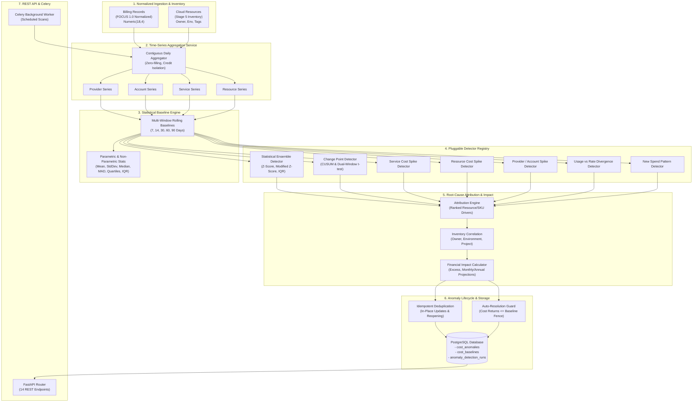

# CloudSage Cost Anomaly Detection Architecture

## 1. Executive Summary

The **CloudSage Cost Anomaly Detection Engine** provides enterprise-grade, continuous statistical and time-series monitoring across multi-cloud infrastructure (Amazon Web Services, Microsoft Azure, Google Cloud Platform).

Designed to address fragmented billing visibility and sudden unbudgeted cloud expenditures, the engine continuously tracks daily expenditure distributions, computes robust non-parametric baselines, isolates unexpected spikes, identifies persistent structural shifts, attributes root causes to specific cloud resources, and projects financial impacts.

```
+---------------------------------------------------------------------------------------------------+
|                                  CLOUDSAGE ADVISORY-ONLY NOTICE                                   |
| CloudSage operates strictly in an advisory, non-intrusive capacity. It NEVER automatically stops, |
| resizes, deletes, terminates, or alters production cloud infrastructure. All outputs are FinOps   |
| advisory findings and root-cause explanations.                                                    |
+---------------------------------------------------------------------------------------------------+
```

---

## 2. End-to-End System Architecture



---

## 3. Core Architectural Principles

1. **Zero-Float Financial Guarantee**:
   All statistical aggregations, baselines, standard deviations, deviations, and projected impacts are evaluated strictly using Python `Decimal` and PostgreSQL `Numeric(18, 4)`. No binary floating-point representation (`float`) is permitted in financial logic.

2. **Credit & Refund Isolation**:
   Negative billing adjustments, promotional credits, and enterprise discounts are isolated from positive expenditure time series. Incorporating negative credits into baseline standard deviation calculations artificially inflates variance, which can suppress real cost spikes or trigger false alarms when legitimate promotional credits expire.

3. **Pluggable & Extensible Detectors**:
   All detection heuristics conform to the `BaseAnomalyDetector` abstract interface and are managed through the centralized `AnomalyDetectorRegistry`. This decoupled design allows adding domain-specific anomaly detection models without modifying the core aggregation or persistence layers.

4. **Multi-Faceted Attribution & Inventory Correlation**:
   Cost anomalies do not exist in isolation. Every detected deviation is immediately correlated with underlying FOCUS 1.0 billing records and Stage 5 `CloudResource` inventory items to identify the exact runaway resource, SKU, owner, and environment.

5. **Auditable Lifecycle Management**:
   The engine tracks every anomaly through states: `DETECTED`, `INVESTIGATING`, `ACKNOWLEDGED`, `RESOLVED`, `DISMISSED`, and `REOPENED`. Dismissals and resolutions require mandatory justifications and user attribution, ensuring auditable FinOps governance.

