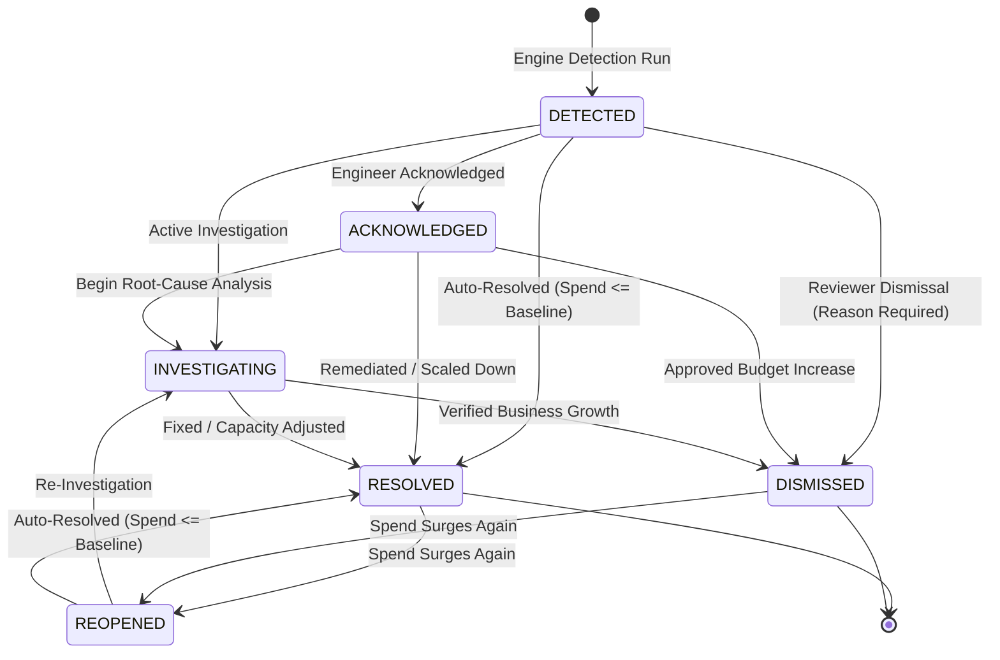

# Cost Anomaly Lifecycle & Review Workflows

## 1. Overview

Effective FinOps requires structured anomaly lifecycle tracking. The **Anomaly Lifecycle State Manager** (`backend/app/anomaly_detection/lifecycle.py`) manages state transitions, ensures idempotent deduplication across repeated scans, automatically resolves anomalies when spending returns to normal, reopens recurring anomalies, and enforces audit requirements for engineer actions.

---

## 2. State Machine Diagram

---

## 3. Lifecycle States & Semantics

| Status | Description | Managed By |
| :--- | :--- | :--- |
| **`DETECTED`** | Initial finding generated by anomaly detection engine. Awaiting triage. | Autonomous Engine |
| **`ACKNOWLEDGED`** | FinOps engineer has seen the anomaly and slated it for investigation. | Human Reviewer |
| **`INVESTIGATING`** | Active engineering root-cause triage and log investigation in progress. | Human Reviewer |
| **`DISMISSED`** | Finding dismissed (e.g. planned load test, seasonal promotion, approved release). Mandatory `dismissal_reason` required. | Human Reviewer |
| **`RESOLVED`** | Anomaly resolved: either manually with `resolution_reason` or automatically when daily spend returns below upper baseline fence. | Human or Engine |
| **`REOPENED`** | Previously resolved or dismissed anomaly where spending surged back above threshold on a subsequent evaluation run. | Autonomous Engine |

---

## 4. Idempotent Deduplication Protocol

Re-running detection scans (e.g. daily, hourly, or on-demand) must never create duplicate records for the same event.

### Natural Deduplication Composite Key
$$\text{Natural Key} = (\text{provider}, \text{account\_id}, \text{service\_name}, \text{resource\_id}, \text{anomaly\_date}, \text{anomaly\_category})$$

### Execution Rules
- **Match Found in Open State (`DETECTED`, `INVESTIGATING`, `ACKNOWLEDGED`)**:
  Updates the record in-place: refreshes `actual_cost`, `estimated_excess_cost`, `confidence_score`, `baseline_metrics`, `root_cause_analysis`, and updates `last_detected_at = now()`.
- **Match Found in Closed State (`RESOLVED`, `DISMISSED`)**:
  If daily spend remains anomalous with positive excess cost, transitions status to `REOPENED`, logs `reopened_at = now()`, and updates financial impact metrics.
- **No Match Found**:
  Inserts a new `CostAnomaly` record with status `DETECTED` and `first_detected_at = now()`.

---

## 5. Autonomous Auto-Resolution

When an active anomaly exists for a service or resource, subsequent detection runs compare current spending against the upper baseline threshold:

$$\text{Upper Threshold} = \mu_{\text{expected}} + (1.5 \cdot \sigma_{\text{baseline}})$$

If current daily expenditure falls back below the threshold:
1. Status is transitioned to `RESOLVED`.
2. `resolution_reason = "AUTO_RESOLVED_RETURN_TO_BASELINE"`.
3. `resolved_by = "CloudSage_Autonomous_Engine"`.
4. Investigation notes document the normalization date and current cost.

