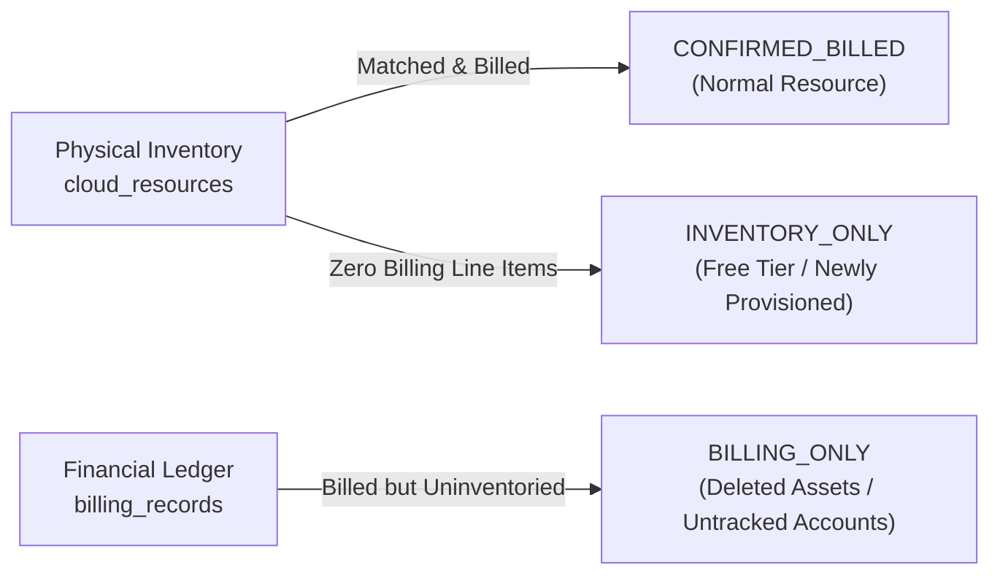

# Billing-to-Inventory Financial Correlation

## 1. Overview

A recurring blind spot in cloud governance is the disconnect between the **financial ledger** (invoices, billing files, FOCUS records) and the **physical infrastructure** (running VMs, provisioned disks, active databases).

The `BillingCorrelationEngine` bridges this divide by joining `BillingRecord` rows with `CloudResource` rows to measure:
- Exact trailing expenditure for every physical asset.
- Financial coverage percentage (what proportion of billed dollars is accounted for in inventory).
- Discrepancy detection (`BILLING_ONLY` vs `INVENTORY_ONLY` resources).

---

## 2. Correlation Taxonomy & Statuses

1. **`CONFIRMED_BILLED`**:
   The resource exists in both `cloud_resources` and `billing_records`. Full financial attribution and unit economics can be calculated.
2. **`INVENTORY_ONLY`**:
   The asset exists in `cloud_resources`, but has generated \$0.00 in billing records. Indicates free-tier usage, stopped instances with zero hourly charges, or brand-new assets deployed within the current hour.
3. **`BILLING_ONLY`**:
   Charges appear on the cloud bill for a resource identifier that has never been confirmed via inventory discovery. Indicates short-lived ephemeral resources (e.g. Lambda, batch jobs) or resources terminated prior to inventory synchronization.

---

## 3. Financial Metrics & Strict Decimal Precision

All cost calculations strictly enforce `Decimal` precision to avoid floating-point rounding errors:

- **`total_billed_cost`**: Sum of `unblended_cost` across all historical line items for this resource.
- **`total_effective_cost`**: Net cost reflecting amortization and committed use discounts.
- **`monthly_cost`**: Trailing 30-day cumulative unblended cost stored directly on `CloudResource.monthly_cost`.
- **`cost_coverage_percentage`**:
  $$\text{Coverage \%} = \frac{\sum \text{Billed Cost of Reconciled Assets}}{\sum \text{Total Billing Ledger Cost}} \times 100$$
