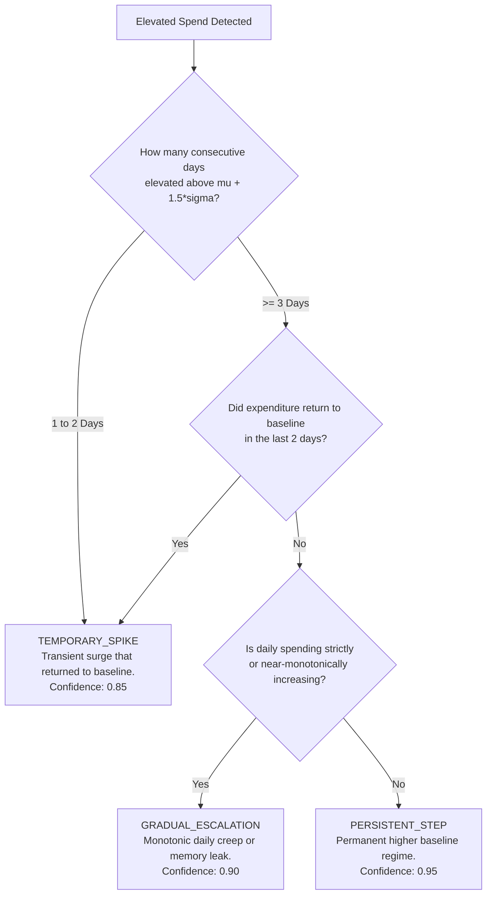

# Change-Point & Structural Shift Detection

## 1. Overview

While statistical anomaly detectors excel at identifying discrete 1-day cost spikes, enterprise cloud environments frequently experience **structural regime shifts**:
- New application versions deployed with larger database instance classes.
- Autoscaling min-instance parameters increased and forgotten.
- Data retention policies shortened or lengthened.
- Ingestion pipelines upgraded to higher log-level verbosity.

The **Change-Point and Structural Shift Engine** (`backend/app/anomaly_detection/change_points.py` and `backend/app/anomaly_detection/detectors/change_point.py`) identifies when cloud spending permanently transitions to a higher baseline level and classifies the pattern into discrete FinOps archetypes.

---

## 2. Dual-Window Comparative Test

The engine continuously splits time-series into two contiguous windows:
1. **Baseline Window ($W_{\text{base}}$)**: Trailing historical period (default 14 to 30 days).
2. **Observation Window ($W_{\text{obs}}$)**: Recent evaluation period (default 7 days).

### Mathematical Formulation
$$\Delta\mu = \mu_{\text{obs}} - \mu_{\text{base}}$$
$$\text{SE}_{\Delta} = \sqrt{\frac{\sigma_{\text{base}}^2}{N_{\text{base}}} + \frac{\sigma_{\text{obs}}^2}{N_{\text{obs}}}}$$
$$t_{\text{Welch}} = \frac{\Delta\mu}{\text{SE}_{\Delta}}$$

### Significance Criteria
A structural shift is confirmed if:
1. $t_{\text{Welch}} \ge 2.0000$ (statistical significance $p < 0.05$)
2. $\Delta\mu \ge \text{min\_shift\_abs}$ (default $\$10.00$)
3. $\frac{\Delta\mu}{\mu_{\text{base}}} \times 100 \ge \text{min\_shift\_pct}$ (default $20.0\%$)

---

## 3. Cumulative Sum (CUSUM) Shift Detection

To identify the exact calendar date when an expenditure shift originated, CloudSage implements an upward Page's CUSUM formulation:

$$S_0 = 0$$
$$S_i = \max\left(0, S_{i-1} + (x_i - (\mu_{\text{base}} + k))\right)$$

Where:
- $k$: Reference allowance or slack parameter ($k = 0.5 \cdot \sigma_{\text{base}}$). Deviations smaller than $k$ do not accumulate.
- $h$: Decision threshold ($h = 4.0 \cdot \sigma_{\text{base}}$).

### Change-Point Date Attribution
When $S_i \ge h$, a structural upward shift is flagged. The exact `change_point_date` is determined as the first index $j \le i$ where $S_j > 0$ initiated the non-zero accumulation run.

---

## 4. Pattern Classification Taxonomy

Once an expenditure deviation is detected, the classifier evaluates consecutive elevated days and slope trajectories:

### Classification Definitions

1. **`TEMPORARY_SPIKE`**:
   - Spending was elevated for 1 or 2 days and returned to the baseline mean.
   - Typical causes: one-off batch data exports, monthly reports, disaster recovery testing.
   - Monthly Impact: Single-occurrence excess cost.

2. **`PERSISTENT_STEP`**:
   - Spending jumped to a new plateau and remained elevated for $\ge 3$ consecutive days without returning to the prior mean.
   - Typical causes: permanent infrastructure resize, new service deployment, architectural change.
   - Monthly Impact: Projected across 30 days ($\text{excess}_{\text{daily}} \times 30$).

3. **`GRADUAL_ESCALATION`**:
   - Spending exhibits monotonic or near-monotonic upward growth over $\ge 4$ consecutive observation days.
   - Typical causes: data accumulation without lifecycle expiration, unconstrained autoscaler creep, memory leak causing pod proliferation.
   - Monthly Impact: Projected based on latest daily growth.
