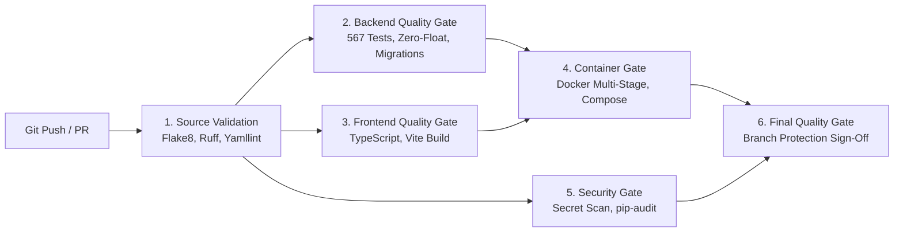

# CloudSage Continuous Integration & Continuous Delivery (CI/CD)

## 1. Overview

CloudSage employs GitHub Actions workflows to automate code quality, security scanning, container builds, and deployment verification.

Workflows reside in:
- `.github/workflows/ci.yml`: Continuous Integration & Quality Gates
- `.github/workflows/cd.yml`: Continuous Delivery, Image Packaging & Rollback

---

## 2. CI Pipeline & Quality Gates

The CI workflow triggers on every push and pull request across `main`, `master`, and `stage-*` branches.

### Detailed Gate Specifications:

| Gate | Scope & Actions | Pass Criteria |
| :--- | :--- | :--- |
| **1. Source Validation** | Flake8 syntax checks, Ruff linting, Yamllint schema check | 0 syntax errors, valid YAML across workflows and compose files |
| **2. Backend Quality Gate** | PostgreSQL 16 + Redis 7 services, Alembic migration test, Pytest suite execution | 567/567 passed, 100% Zero-Float assertion |
| **3. Frontend Quality Gate** | Node 20 runtime, `npx tsc --noEmit`, `npm run build` | 0 TypeScript compilation errors, production bundle generated |
| **4. Container Quality Gate** | Docker Buildx dry-run for backend, frontend, and ingress; `docker compose config` | All multi-stage targets compile cleanly; compose specs valid |
| **5. Security & Supply Chain** | `pip-audit` CVE inspection, regex secret leak prevention scan | 0 hardcoded cloud credentials or unencrypted private keys |
| **6. Final Quality Gate** | Aggregates status across all preceding jobs | Mandatory check required for branch merge approval |

---

## 3. CD Pipeline & Safe Deployment

The CD workflow triggers on semantic version tags (`v*.*.*`) or manual `workflow_dispatch`.

### Deployment Stages:
1. **Package & Publish:**
   - Multi-platform Docker builds targeting `linux/amd64` and `linux/arm64`.
   - Tags container images with git commit SHA and release version (`v0.15.0`, `latest`).
2. **Staging Environment Deployment:**
   - Deploys container stack to staging cluster.
   - Executes `alembic upgrade head`.
   - Polls `/health/dependencies` until all subsystems report `healthy`.
3. **Production Safe Blue/Green Deployment:**
   - **Step 3A:** Creates pre-deployment automated database backup via `backup_db.sh`.
   - **Step 3B:** Applies non-destructive schema migrations.
   - **Step 3C:** Performs rolling container upgrade.
   - **Step 3D:** Deep health probe verification.
   - **Step 3E (Emergency Rollback):** If healthchecks fail within the verification window, the workflow triggers an automated rollback to the prior release tag.

