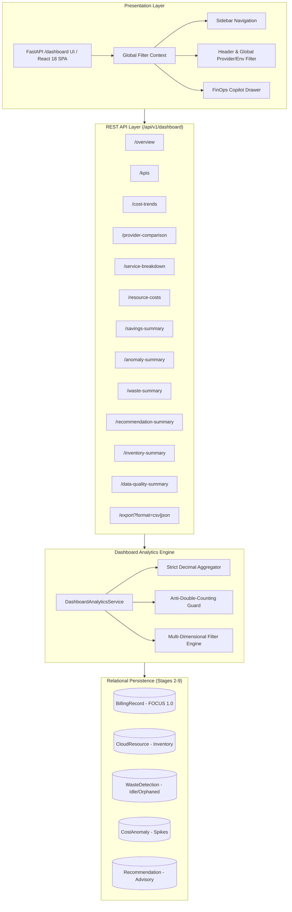

# CloudSage – Interactive FinOps Dashboards & Data Visualization Architecture

## 1. Executive Summary

Stage 10 implements the **Interactive Multi-Cloud FinOps Dashboard & Command Center** for CloudSage. This layer transforms the underlying ingestion, normalization, discovery, waste detection, anomaly detection, recommendation scoring, and AI copilot intelligence (Stages 3–9) into an enterprise visual command center.

The architecture delivers both:
1. **Interactive HTML5 Single-Page Application (SPA)**: Embedded directly into FastAPI at `/dashboard` (and `/api/v1/dashboard/ui`) with live multi-cloud filtering, Chart.js visualizers, and a slide-out AI FinOps Copilot drawer.
2. **Modular React 18 TypeScript Frontend Architecture**: A clean, scalable enterprise codebase in `frontend/` featuring strict typing, reusable components, context-driven multi-dimensional filtering, and dedicated pages for every FinOps domain.

---

## 2. Architectural Blueprint



---

## 3. Core Architectural Principles

### 3.1 Strict Zero Float Rule
- All financial metrics (total spend, MTD spend, MoM percentage, excess anomaly impact, identified waste, potential and realized savings) are computed exclusively using Python `Decimal` and PostgreSQL `Numeric(18, 4)`.
- Zero floating-point rounding drift across cross-provider aggregations or currency displays.

### 3.2 Anti-Double-Counting Guarantee
- Cloud expenditure, detected waste, cost anomalies, and optimization recommendations are kept completely segregated:
  $$\text{Spend} \neq \text{Waste} \neq \text{Anomalies} \neq \text{Recommendations}$$
- Potential savings and realized savings are audited separately to prevent inflating financial returns.

### 3.3 Advisory-Only Governance
- The dashboard is strictly observational and advisory.
- Zero infrastructure mutation capability is exposed on any endpoint.
- User actions (approve, endorse, dismiss) transition review states in the FinOps ledger without touching cloud provider resources.

---

## 4. API Endpoints Reference

| Endpoint | Method | Response Model | Description |
|---|---|---|---|
| `/api/v1/dashboard/overview` | GET | `DashboardOverviewResponse` | Consolidated command center metrics and suggested questions |
| `/api/v1/dashboard/kpis` | GET | `ExecutiveKpiSummary` | Executive KPI cards with MoM change and freshness timestamp |
| `/api/v1/dashboard/cost-trends` | GET | `CostTrendResponse` | Daily/monthly multi-cloud historical series with anomaly overlays |
| `/api/v1/dashboard/provider-comparison` | GET | `ProviderComparisonResponse` | AWS, Azure, GCP cost shares and resource counts |
| `/api/v1/dashboard/service-breakdown` | GET | `ServiceBreakdownResponse` | Top consuming hyperscaler services ranking |
| `/api/v1/dashboard/resource-costs` | GET | `ResourceCostsResponse` | Top cost-driving cloud resources |
| `/api/v1/dashboard/savings-summary` | GET | `SavingsSummaryResponse` | Potential vs verified savings pipeline |
| `/api/v1/dashboard/anomaly-summary` | GET | `AnomalySummaryResponse` | Statistical spike counts, severity, and excess impact |
| `/api/v1/dashboard/waste-summary` | GET | `WasteSummaryResponse` | Idle compute, unattached storage, and run-rate waste |
| `/api/v1/dashboard/recommendation-summary` | GET | `RecommendationSummaryResponse` | Prioritized savings actions by effort and priority |
| `/api/v1/dashboard/inventory-summary` | GET | `InventorySummaryResponse` | Tracked resources, status distribution, tag coverage |
| `/api/v1/dashboard/data-quality-summary` | GET | `DataQualitySummaryResponse` | FOCUS 1.0 compliance and tag governance scores |
| `/api/v1/dashboard/export` | GET | CSV / JSON Stream | Filter-aware export of dashboard datasets |
| `/api/v1/dashboard/ui` | GET | HTML5 Single Page App | Interactive FinOps Command Center web application |
| `/dashboard` | GET | 307 Redirect | Top-level redirect to `/api/v1/dashboard/ui` |

---

## 5. Frontend Architecture (`frontend/`)

```
frontend/
├── package.json               # Dependencies (React 18, React Router, Lucide, Tailwind)
├── tsconfig.json              # Strict TypeScript compiler options
└── src/
    ├── types/
    │   └── dashboard.ts       # TypeScript models matching Pydantic schemas
    ├── services/
    │   └── api.ts             # Axios client for REST & Copilot APIs
    ├── context/
    │   └── FilterContext.tsx  # Multi-cloud global filter state provider
    ├── components/
    │   ├── Header.tsx         # Global filter bar, refresh, export, Copilot launcher
    │   ├── Sidebar.tsx        # Navigation menu & FOCUS 1.0 status badge
    │   ├── KpiCard.tsx        # Formatted financial cards with MoM trend arrows
    │   ├── Charts.tsx         # Stacked spend trend, provider donut, service list
    │   └── CopilotDrawer.tsx  # Slide-out AI assistant with question suggestions
    ├── pages/
    │   ├── OverviewPage.tsx   # Executive Command Center view
    │   ├── CostAnalyticsPage.tsx # Deep cost analytics & time-series trends
    │   ├── AnomalyPage.tsx    # Spike detection & incident investigation
    │   ├── WastePage.tsx      # Idle compute & unattached storage
    │   ├── RecommendationsPage.tsx # Prioritized advisory recommendations
    │   ├── SavingsPage.tsx    # Realized vs potential savings pipeline
    │   ├── InventoryPage.tsx  # Discovered multi-cloud assets & tags
    │   └── QualityPage.tsx    # FOCUS 1.0 compliance & ingestion health
    ├── App.tsx                # Layout routing wrapper
    └── main.tsx               # Application bootstrap
```
