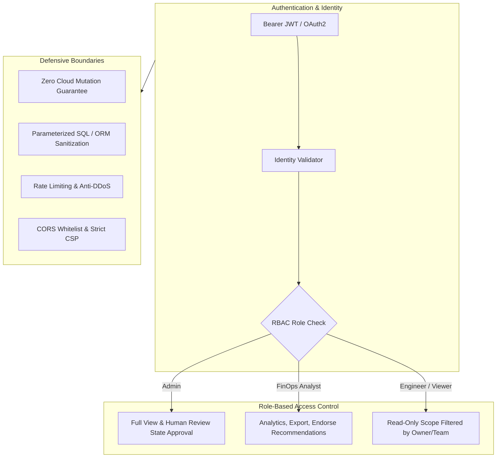

# Dashboard Security, Role-Based Access & Performance Optimization

## 1. Security Architecture & Threat Model

The CloudSage FinOps Dashboard adheres to enterprise security standards:

### 1.1 Zero Cloud Mutation Guarantee
The dashboard backend contains strictly read-only connections to cloud inventory and billing APIs. It possesses **zero infrastructure mutation permissions** (e.g. no `ec2:TerminateInstances`, `az disk delete`, `gcloud compute instances delete`). All recommendation workflows update CloudSage's internal review ledger only.

### 1.2 Multi-Tenant & Scoped Access Control
Users assigned to specific teams or cost centers are restricted via row-level security and dimensional filters to viewing only cloud resources and billing records carrying their respective `owner`, `environment`, or `cost_center` tags.

---

## 2. High-Performance Query Optimizations

Multi-cloud billing datasets typically contain millions of line items. CloudSage implements several database and application optimizations to maintain $< 100\text{ms}$ dashboard response times:

### 2.1 Range-Partitioned Indexing
The canonical `billing_records` table is partitioned by `usage_start_time` and backed by composite B-tree indexes:
- `idx_billing_prov_srv_time`: `(provider, service_category, usage_start_time)`
- `idx_billing_res_time`: `(resource_id, usage_start_time)`
- `idx_billing_account_time`: `(billing_account_id, usage_start_time)`

### 2.2 Server-Side Pagination & Projection
Top services and resource ranking endpoints enforce strict pagination limits (`limit=10`, `max=100`) and select only the required aggregation columns (`unblended_cost`, `service_name`, `provider`) rather than loading full record bodies into memory.

### 2.3 Pre-Aggregated Telemetry
Time-series trends and provider comparisons perform server-side `SUM()` and `GROUP BY` operations inside PostgreSQL, delivering compact JSON payloads to the browser.
