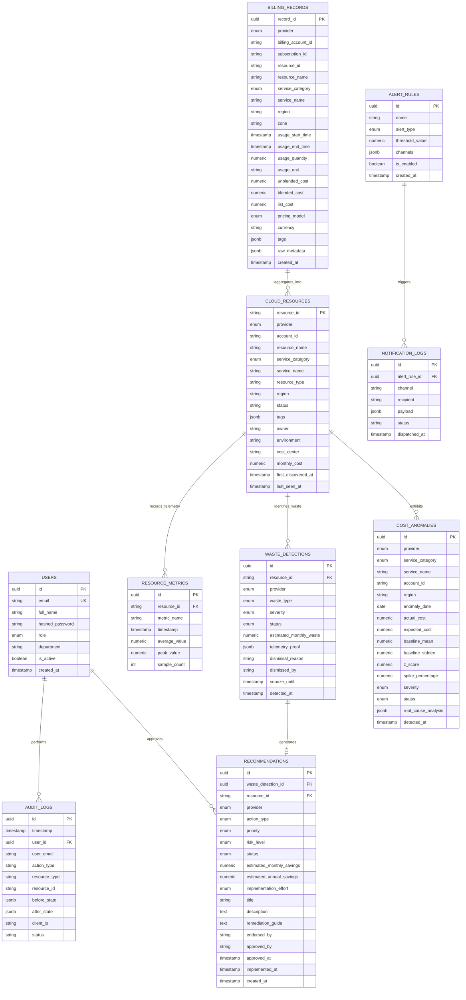

# CloudSage: Database Schema & Relational Data Architecture

## 1. Overview and Design Principles

CloudSage analytical storage is engineered on **PostgreSQL 16+** to serve as the unified, high-performance financial ledger across Amazon Web Services (AWS), Microsoft Azure, and Google Cloud Platform (GCP).

### Core Architectural Principles:
1. **FOCUS™ 1.0 Alignment**: The normalized billing schema aligns strictly with the FinOps Open Cost & Usage Specification (FOCUS™), ensuring standardized multi-cloud column taxonomy.
2. **Penny-Accurate Financial Precision**: All monetary values enforce `NUMERIC(18, 4)` and Python `Decimal`. Floating-point types (`FLOAT`, `DOUBLE`, `REAL`) are strictly prohibited in the financial data pipeline.
3. **Native Declarative Range Partitioning**: Billing records are partitioned by `usage_start_time` in monthly intervals to guarantee high query throughput as datasets expand into tens of millions of records.
4. **Hybrid Relational & JSONB Storage**: Structured relational attributes are indexed via B-Tree and BRIN indexes, while dynamic multi-cloud metadata tags are stored in `JSONB` with GIN indexing.
5. **Separation of Concerns & Auditability**: System state changes, recommendation approvals, user authentications, and Copilot queries are recorded in an append-only immutable audit ledger.

---

## 2. Entity-Relationship Diagram (ERD)



---

## 3. Table Schema Specifications

### 3.1 Table: `billing_records` (Partitioned Table)
Stores canonical FOCUS 1.0 normalized billing line items. Partitioned by `usage_start_time` (monthly ranges).

| Column Name | SQL Type | Constraints / Nullable | Description |
| :--- | :--- | :--- | :--- |
| `record_id` | `UUID` | `NOT NULL, DEFAULT gen_random_uuid()` | Primary identifier of the normalized billing record |
| `provider` | `VARCHAR(16)` | `NOT NULL` | Cloud provider: `AWS`, `AZURE`, `GCP` |
| `billing_account_id`| `VARCHAR(64)` | `NOT NULL` | Payer or billing account ID |
| `subscription_id` | `VARCHAR(64)` | `NOT NULL` | Account / Subscription / Project ID |
| `resource_id` | `VARCHAR(512)`| `NOT NULL` | Cloud resource identifier (ARN / Azure URI / GCP URI) |
| `resource_name` | `VARCHAR(256)`| `NULL` | Human-readable name or VM tag |
| `service_category` | `VARCHAR(32)` | `NOT NULL` | High-level taxonomy (`COMPUTE`, `STORAGE`, `DATABASE`, etc.) |
| `service_name` | `VARCHAR(128)`| `NOT NULL` | Hyperscaler service name (e.g., `AmazonEC2`, `Virtual Machines`) |
| `region` | `VARCHAR(64)` | `NOT NULL` | Cloud region (e.g., `us-east-1`, `eastus`) |
| `zone` | `VARCHAR(64)` | `NULL` | Availability zone (e.g., `us-east-1a`) |
| `usage_start_time` | `TIMESTAMPTZ` | `NOT NULL` | Billing interval start timestamp (Partition Key) |
| `usage_end_time` | `TIMESTAMPTZ` | `NOT NULL` | Billing interval end timestamp |
| `usage_quantity` | `NUMERIC(18, 6)`| `NOT NULL, DEFAULT 0.0` | Billed volume (hours, GB-month, requests) |
| `usage_unit` | `VARCHAR(32)` | `NOT NULL` | Normalized usage unit (e.g., `HOURS`, `GB_MONTH`) |
| `unblended_cost` | `NUMERIC(18, 4)`| `NOT NULL, DEFAULT 0.0000` | Net billed cost in USD |
| `blended_cost` | `NUMERIC(18, 4)`| `NULL` | Blended cost if applicable |
| `list_cost` | `NUMERIC(18, 4)`| `NULL` | Standard public list price |
| `pricing_model` | `VARCHAR(32)` | `NOT NULL, DEFAULT 'ON_DEMAND'`| `ON_DEMAND`, `RESERVED`, `SPOT`, `SAVINGS_PLAN` |
| `currency` | `VARCHAR(8)` | `NOT NULL, DEFAULT 'USD'` | Currency standard |
| `tags` | `JSONB` | `NOT NULL, DEFAULT '{}'` | Sanitized key-value metadata tags |
| `raw_metadata` | `JSONB` | `NULL` | Provider-specific original line-item attributes for audit |
| `created_at` | `TIMESTAMPTZ` | `NOT NULL, DEFAULT NOW()` | Record ingestion timestamp |

#### Primary Key & Partitioning Strategy:
- **Composite Primary Key**: `(record_id, usage_start_time)`
- **Partition Type**: `PARTITION BY RANGE (usage_start_time)`
- **Partition Cadence**: 1 partition per calendar month (e.g., `billing_records_y2026m01`, `billing_records_y2026m02`).

---

### 3.2 Table: `cloud_resources`
Maintains current state inventory and aggregate telemetry across all discovered cloud infrastructure.

| Column Name | SQL Type | Constraints / Nullable | Description |
| :--- | :--- | :--- | :--- |
| `resource_id` | `VARCHAR(512)`| `PRIMARY KEY` | Globally unique cloud resource identifier |
| `provider` | `VARCHAR(16)` | `NOT NULL` | `AWS`, `AZURE`, `GCP` |
| `account_id` | `VARCHAR(64)` | `NOT NULL` | Account / Subscription / Project ID |
| `resource_name` | `VARCHAR(256)`| `NULL` | Resource name |
| `service_category` | `VARCHAR(32)` | `NOT NULL` | Standardized category |
| `service_name` | `VARCHAR(128)`| `NOT NULL` | Cloud service name |
| `resource_type` | `VARCHAR(64)` | `NOT NULL` | Specific type (e.g. `ec2:instance`, `managed_disk`) |
| `region` | `VARCHAR(64)` | `NOT NULL` | Deployment region |
| `status` | `VARCHAR(32)` | `NOT NULL` | Resource status (`running`, `stopped`, `available`, etc.) |
| `tags` | `JSONB` | `NOT NULL, DEFAULT '{}'` | Current normalized resource tags |
| `owner` | `VARCHAR(128)`| `NULL` | Extracted owner identity from tags |
| `environment` | `VARCHAR(64)` | `NOT NULL, DEFAULT 'unknown'` | `production`, `staging`, `dev`, `test` |
| `cost_center` | `VARCHAR(64)` | `NULL` | Departmental or financial cost center |
| `monthly_cost` | `NUMERIC(18, 4)`| `NOT NULL, DEFAULT 0.0000` | Trailing 30-day aggregate cost |
| `first_discovered_at`| `TIMESTAMPTZ` | `NOT NULL, DEFAULT NOW()` | Initial discovery timestamp |
| `last_seen_at` | `TIMESTAMPTZ` | `NOT NULL, DEFAULT NOW()` | Latest confirmation timestamp |

---

### 3.3 Table: `resource_metrics`
Time-series utilization telemetry harvested from CloudWatch, Azure Monitor, and GCP Cloud Monitoring.

| Column Name | SQL Type | Constraints / Nullable | Description |
| :--- | :--- | :--- | :--- |
| `id` | `UUID` | `PRIMARY KEY, DEFAULT gen_random_uuid()` | Metric sample ID |
| `resource_id` | `VARCHAR(512)`| `NOT NULL, FK -> cloud_resources` | Target resource |
| `metric_name` | `VARCHAR(64)` | `NOT NULL` | `cpu_utilization_pct`, `network_bytes_total`, `disk_iops` |
| `timestamp` | `TIMESTAMPTZ` | `NOT NULL` | Metric sample interval timestamp |
| `average_value` | `NUMERIC(10, 4)`| `NOT NULL` | Average observed value |
| `peak_value` | `NUMERIC(10, 4)`| `NOT NULL` | Peak observed value |
| `sample_count` | `INTEGER` | `NOT NULL, DEFAULT 1` | Observation count |

---

### 3.4 Table: `waste_detections`
Records detected cloud waste resulting from heuristic analysis.

| Column Name | SQL Type | Constraints / Nullable | Description |
| :--- | :--- | :--- | :--- |
| `id` | `UUID` | `PRIMARY KEY, DEFAULT gen_random_uuid()` | Waste detection record ID |
| `resource_id` | `VARCHAR(512)`| `NOT NULL, FK -> cloud_resources` | Target resource |
| `provider` | `VARCHAR(16)` | `NOT NULL` | `AWS`, `AZURE`, `GCP` |
| `waste_type` | `VARCHAR(32)` | `NOT NULL` | `IDLE_VM`, `OVERSIZED_COMPUTE`, `UNATTACHED_DISK`, etc. |
| `severity` | `VARCHAR(16)` | `NOT NULL` | `LOW`, `MEDIUM`, `HIGH`, `CRITICAL` |
| `status` | `VARCHAR(16)` | `NOT NULL, DEFAULT 'ACTIVE'` | `ACTIVE`, `SNOOZED`, `DISMISSED`, `RESOLVED` |
| `estimated_monthly_waste`| `NUMERIC(18, 4)`| `NOT NULL` | Projected monthly dollar leakage |
| `telemetry_proof` | `JSONB` | `NOT NULL` | Supporting metrics (avg CPU %, network IO, disk attachment) |
| `dismissal_reason` | `VARCHAR(512)`| `NULL` | Justification if dismissed |
| `dismissed_by` | `VARCHAR(128)`| `NULL` | Identity of reviewer |
| `snooze_until` | `TIMESTAMPTZ` | `NULL` | Snooze expiry timestamp |
| `detected_at` | `TIMESTAMPTZ` | `NOT NULL, DEFAULT NOW()` | Detection timestamp |

---

### 3.5 Table: `recommendations`
Advisory optimization proposals with human-in-the-loop review governance.

| Column Name | SQL Type | Constraints / Nullable | Description |
| :--- | :--- | :--- | :--- |
| `id` | `UUID` | `PRIMARY KEY, DEFAULT gen_random_uuid()` | Recommendation ID |
| `waste_detection_id`| `UUID` | `NULL, FK -> waste_detections` | Originating waste detection |
| `resource_id` | `VARCHAR(512)`| `NOT NULL, FK -> cloud_resources` | Target resource |
| `provider` | `VARCHAR(16)` | `NOT NULL` | `AWS`, `AZURE`, `GCP` |
| `action_type` | `VARCHAR(32)` | `NOT NULL` | `TERMINATE`, `RIGHTSIZE`, `SCHEDULE_SHUTDOWN`, etc. |
| `priority` | `VARCHAR(8)` | `NOT NULL` | `P1`, `P2`, `P3`, `P4` |
| `risk_level` | `VARCHAR(16)` | `NOT NULL` | `NONE`, `LOW`, `MEDIUM`, `HIGH` |
| `status` | `VARCHAR(16)` | `NOT NULL, DEFAULT 'PROPOSED'`| `PROPOSED`, `UNDER_REVIEW`, `ENDORSED`, `APPROVED`, etc. |
| `estimated_monthly_savings`| `NUMERIC(18, 4)`| `NOT NULL` | Projected monthly dollar savings |
| `estimated_annual_savings` | `NUMERIC(18, 4)`| `NOT NULL` | Projected annual dollar savings ($12 \times \text{monthly}$) |
| `implementation_effort`| `VARCHAR(16)`| `NOT NULL` | `LOW`, `MEDIUM`, `HIGH` |
| `title` | `VARCHAR(256)`| `NOT NULL` | Summary headline |
| `description` | `TEXT` | `NOT NULL` | Comprehensive rationale |
| `remediation_guide`| `TEXT` | `NOT NULL` | Manual steps, CLI command, or Terraform guidance |
| `endorsed_by` | `VARCHAR(128)`| `NULL` | Finance Analyst identity |
| `approved_by` | `VARCHAR(128)`| `NULL` | Engineering Lead / FinOps Engineer identity |
| `approved_at` | `TIMESTAMPTZ` | `NULL` | Timestamp of formal approval |
| `implemented_at` | `TIMESTAMPTZ` | `NULL` | Timestamp of manual implementation |
| `created_at` | `TIMESTAMPTZ` | `NOT NULL, DEFAULT NOW()` | Proposal timestamp |

---

### 3.6 Table: `cost_anomalies`
Statistical expenditure anomalies identified by the Anomaly Engine.

| Column Name | SQL Type | Constraints / Nullable | Description |
| :--- | :--- | :--- | :--- |
| `id` | `UUID` | `PRIMARY KEY, DEFAULT gen_random_uuid()` | Anomaly ID |
| `provider` | `VARCHAR(16)` | `NOT NULL` | `AWS`, `AZURE`, `GCP` |
| `service_category` | `VARCHAR(32)` | `NOT NULL` | Service category |
| `service_name` | `VARCHAR(128)`| `NOT NULL` | Cloud service name |
| `account_id` | `VARCHAR(64)` | `NOT NULL` | Account / Subscription ID |
| `region` | `VARCHAR(64)` | `NOT NULL` | Region of anomaly |
| `anomaly_date` | `DATE` | `NOT NULL` | Date when spike occurred |
| `actual_cost` | `NUMERIC(18, 4)`| `NOT NULL` | Observed spending |
| `expected_cost` | `NUMERIC(18, 4)`| `NOT NULL` | Baseline expected spending |
| `baseline_mean` | `NUMERIC(18, 4)`| `NOT NULL` | 30-day rolling mean ($\mu$) |
| `baseline_stddev`| `NUMERIC(18, 4)`| `NOT NULL` | 30-day rolling standard deviation ($\sigma$) |
| `z_score` | `NUMERIC(8, 4)` | `NOT NULL` | Statistical standard score |
| `spike_percentage` | `NUMERIC(8, 2)` | `NOT NULL` | Percentage increase over baseline |
| `severity` | `VARCHAR(16)` | `NOT NULL` | `LOW`, `MEDIUM`, `HIGH`, `CRITICAL` |
| `status` | `VARCHAR(16)` | `NOT NULL, DEFAULT 'OPEN'` | `OPEN`, `ACKNOWLEDGED`, `RESOLVED`, `FALSE_POSITIVE` |
| `root_cause_analysis`| `JSONB` | `NOT NULL` | Resource attribution, driver service, volume delta |
| `detected_at` | `TIMESTAMPTZ` | `NOT NULL, DEFAULT NOW()` | Detection timestamp |

---

### 3.7 Table: `users`
System user accounts, credentials, and role assignments.

| Column Name | SQL Type | Constraints / Nullable | Description |
| :--- | :--- | :--- | :--- |
| `id` | `UUID` | `PRIMARY KEY, DEFAULT gen_random_uuid()` | User ID |
| `email` | `VARCHAR(256)`| `NOT NULL, UNIQUE` | User email address |
| `full_name` | `VARCHAR(128)`| `NOT NULL` | Full name |
| `hashed_password`| `VARCHAR(256)`| `NOT NULL` | Argon2 / bcrypt password hash |
| `role` | `VARCHAR(32)` | `NOT NULL` | `SUPER_ADMIN`, `FINOPS_ENGINEER`, `FINANCE_ANALYST`, etc. |
| `department` | `VARCHAR(64)` | `NULL` | Department for ABAC scoping |
| `is_active` | `BOOLEAN` | `NOT NULL, DEFAULT TRUE` | Active status flag |
| `created_at` | `TIMESTAMPTZ` | `NOT NULL, DEFAULT NOW()` | Account creation timestamp |

---

### 3.8 Table: `audit_logs`
Append-only immutable audit trail capturing all privileged and analytical events.

| Column Name | SQL Type | Constraints / Nullable | Description |
| :--- | :--- | :--- | :--- |
| `id` | `UUID` | `PRIMARY KEY, DEFAULT gen_random_uuid()` | Audit event ID |
| `timestamp` | `TIMESTAMPTZ` | `NOT NULL, DEFAULT NOW()` | Event occurrence timestamp |
| `user_id` | `UUID` | `NULL, FK -> users` | Initiating user ID |
| `user_email` | `VARCHAR(256)`| `NULL` | Initiating user email |
| `action_type` | `VARCHAR(64)` | `NOT NULL` | `LOGIN`, `RECOMMENDATION_APPROVE`, `COPILOT_QUERY`, etc. |
| `resource_type` | `VARCHAR(64)` | `NOT NULL` | Target entity type (`recommendation`, `waste`, `billing`) |
| `resource_id` | `VARCHAR(512)`| `NULL` | Target resource identifier |
| `before_state` | `JSONB` | `NULL` | Entity state prior to change |
| `after_state` | `JSONB` | `NULL` | Entity state after change |
| `client_ip` | `VARCHAR(64)` | `NULL` | Client IP address |
| `status` | `VARCHAR(16)` | `NOT NULL, DEFAULT 'SUCCESS'`| Execution result (`SUCCESS`, `FAILURE`) |

---

### 3.9 Table: `alert_rules` & `notification_logs`
Manages threshold configuration and multi-channel notification audit logs.

| Table | Column Name | SQL Type | Description |
| :--- | :--- | :--- | :--- |
| `alert_rules` | `id` | `UUID PK` | Alert rule ID |
| `alert_rules` | `name` | `VARCHAR(128)` | User-defined alert name |
| `alert_rules` | `alert_type` | `VARCHAR(32)` | `BUDGET_THRESHOLD`, `ANOMALY_ZSCORE`, `HIGH_VALUE_WASTE` |
| `alert_rules` | `threshold_value`| `NUMERIC(18, 4)`| Numerical threshold (e.g., $1000 or Z-Score 3.0) |
| `alert_rules` | `channels` | `JSONB` | Target webhooks, emails, and channels |
| `alert_rules` | `is_enabled` | `BOOLEAN` | Active toggle flag |
| `alert_rules` | `created_at` | `TIMESTAMPTZ` | Creation timestamp |
| `notification_logs`| `id` | `UUID PK` | Delivery log ID |
| `notification_logs`| `alert_rule_id` | `UUID FK` | Originating rule ID |
| `notification_logs`| `channel` | `VARCHAR(32)` | `SLACK`, `TEAMS`, `EMAIL`, `WEBHOOK` |
| `notification_logs`| `recipient` | `VARCHAR(256)` | Delivery address / channel URL |
| `notification_logs`| `payload` | `JSONB` | Outbound message body |
| `notification_logs`| `status` | `VARCHAR(16)` | `DELIVERED`, `FAILED` |
| `notification_logs`| `dispatched_at`| `TIMESTAMPTZ` | Dispatch timestamp |

---

## 4. Indexing and Optimization Strategy

```sql
-- GIN Index on dynamic metadata tags for sub-millisecond filtering
CREATE INDEX idx_billing_records_tags ON billing_records USING GIN (tags);
CREATE INDEX idx_cloud_resources_tags ON cloud_resources USING GIN (tags);

-- Composite B-Tree Indexes on billing queries
CREATE INDEX idx_billing_provider_service_time ON billing_records (provider, service_category, usage_start_time);
CREATE INDEX idx_billing_resource_time ON billing_records (resource_id, usage_start_time);

-- BRIN Index for time-ordered analytical range queries on partitioned records
CREATE INDEX idx_billing_brin_time ON billing_records USING BRIN (usage_start_time);

-- Indexes for active waste and open recommendations
CREATE INDEX idx_waste_active ON waste_detections (status, provider) WHERE status = 'ACTIVE';
CREATE INDEX idx_recommendations_review ON recommendations (status, priority) WHERE status IN ('PROPOSED', 'UNDER_REVIEW');
CREATE INDEX idx_anomalies_open ON cost_anomalies (status, anomaly_date) WHERE status = 'OPEN';
```
