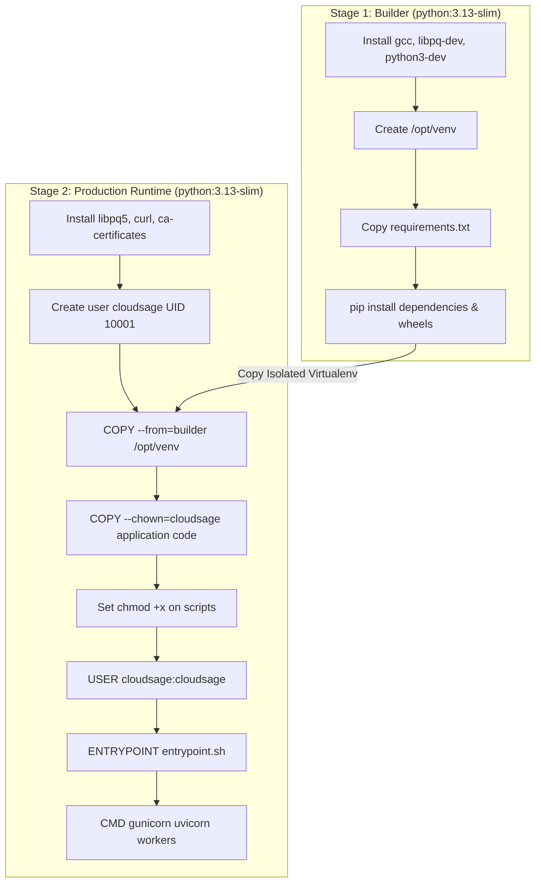
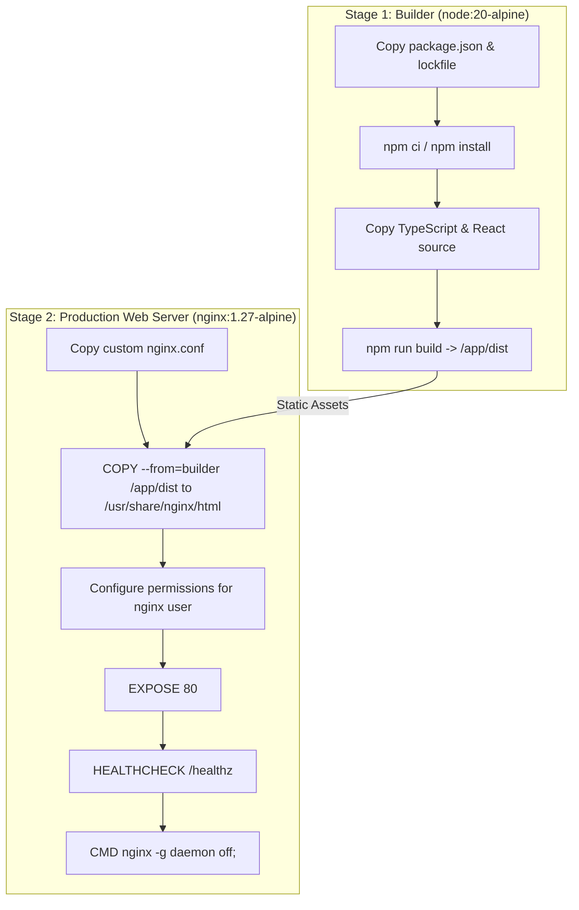

# CloudSage Container Architecture & Multi-Stage Builds

## 1. Architectural Overview

CloudSage employs a defense-in-depth, multi-stage containerization model designed to achieve four core engineering requirements:
1. **Minimal Attack Surface:** Eliminates build-time dependencies, compilers, and debugging utilities from runtime images.
2. **Strict Least Privilege:** Executes all container processes as an unprivileged, non-root user (`cloudsage:cloudsage`, UID 10001, GID 10001).
3. **Reproducible Layer Caching:** Orders Dockerfile instructions from least frequently changed (OS dependencies, system packages) to most frequently changed (application source code) to optimize CI/CD caching.
4. **Deterministic Health Checking:** Embeds non-destructive, lightweight healthchecks within container metadata.

---

## 2. Backend Container Architecture (`backend/Dockerfile`)

### Layer Breakdown:
- **Base Image:** `python:3.13-slim` (Debian Bookworm minimal footprint).
- **Builder Stage:**
  - Installs compilation toolchains (`gcc`, `libpq-dev`, `python3-dev`, `curl`).
  - Creates an isolated virtual environment at `/opt/venv`.
  - Upgrades `pip`, `setuptools`, and `wheel` before installing pinned dependencies.
- **Production Stage:**
  - Installs shared libraries needed for PostgreSQL runtime (`libpq5`) and `curl` for container healthchecks.
  - Drops root privileges: `groupadd -g 10001 cloudsage && useradd -u 10001 -g cloudsage -s /bin/bash -m cloudsage`.
  - Sets environment flags: `PYTHONUNBUFFERED=1`, `PYTHONDONTWRITEBYTECODE=1`, `ENVIRONMENT=production`.
  - Port `8000` exposed.
  - `HEALTHCHECK` verifies process liveness every 30 seconds via `curl -f http://localhost:8000/health/liveness || exit 1`.

---

## 3. Frontend Container Architecture (`frontend/Dockerfile`)

### Key Frontend Capabilities:
- Single-Page Application (SPA) fallback: `try_files $uri $uri/ /index.html;`
- Security Headers: `X-Frame-Options: DENY`, `X-Content-Type-Options: nosniff`, `Content-Security-Policy`.
- Gzip compression level 6 across all JS, CSS, JSON, and SVG assets.
- Immutable cache headers for static bundles (`Cache-Control: public, max-age=15552000, immutable`).

---

## 4. Ingress Reverse Proxy (`nginx/nginx.conf`)

The root reverse proxy unifies access behind a single endpoint:
- `/api/` routed to backend cluster with a 30 req/s rate-limiting zone.
- `/api/v1/auth/login` protected with a strict 5 req/s rate-limiting zone.
- `/docs`, `/redoc`, `/openapi.json` mapped to backend.
- `/health`, `/metrics`, `/dashboard` mapped to backend.
- `/` mapped to frontend static assets.
- Logging formatted as structured JSON for log collection agents (Fluentd, Vector, Datadog).

