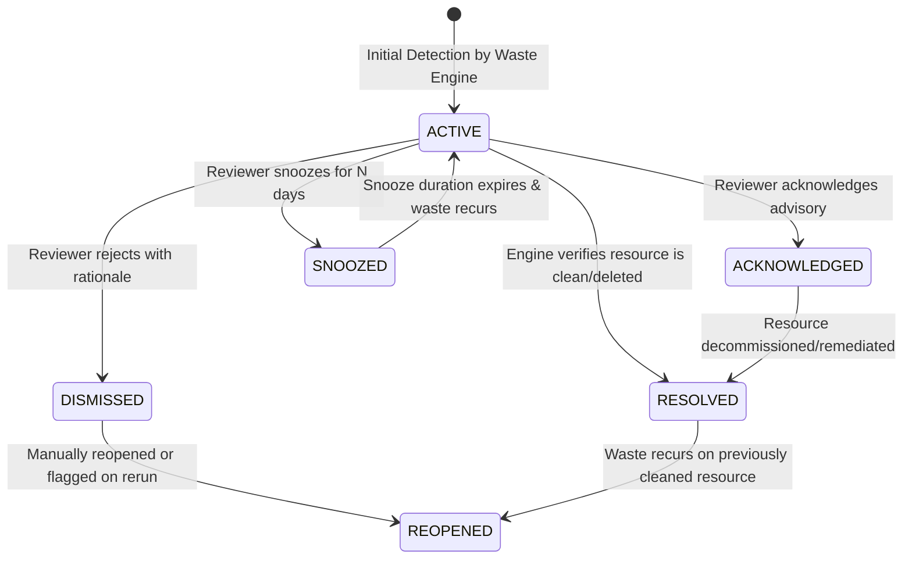

# CloudSage Waste Finding Lifecycle & Governance Specification

## 1. Finding Lifecycle Overview

Cloud waste findings are living financial signals that evolve over time as infrastructure changes, engineers respond to advisories, and workloads fluctuate.

CloudSage manages findings through a formal state machine that ensures auditability, prevents alert fatigue, and maintains a complete historical record.

---

## 2. State Machine & Transitions

---

## 3. State Definitions

- **`ACTIVE`**: Newly detected or active waste finding pending human review. Included in active potential savings summaries.
- **`ACKNOWLEDGED`**: Reviewed and accepted by a FinOps or DevOps engineer. Remediation is planned.
- **`SNOOZED`**: Temporarily suppressed from active alert notifications until a specified date (`snooze_until`). Commonly used during active migration sprints or planned maintenance windows.
- **`DISMISSED`**: Rejected by an authorized reviewer. Requires mandatory `dismissal_reason` (e.g. disaster recovery standby node, regulatory requirement) and captures `dismissed_by`.
- **`RESOLVED`**: Automatically transitioned by the engine when a subsequent detection run confirms the resource has been detached, stopped, downsized, deleted, or resumed normal utilization.
- **`REOPENED`**: Automatically transitioned by the engine when a previously resolved finding exhibits waste recurrence.

---

## 4. Human-in-the-Loop Review Auditability

When an engineer modifies a finding via `PATCH /api/v1/waste-detection/findings/{finding_id}/status`, the system records:
1. `status`: Target state (`ACKNOWLEDGED`, `DISMISSED`, `RESOLVED`, `SNOOZED`).
2. `dismissal_reason`: Free-text justification.
3. `dismissed_by`: User or service principal email.
4. `snooze_until`: ISO 8601 timestamp calculated from `snooze_days`.
5. `last_evaluated_at`: Review action timestamp.
