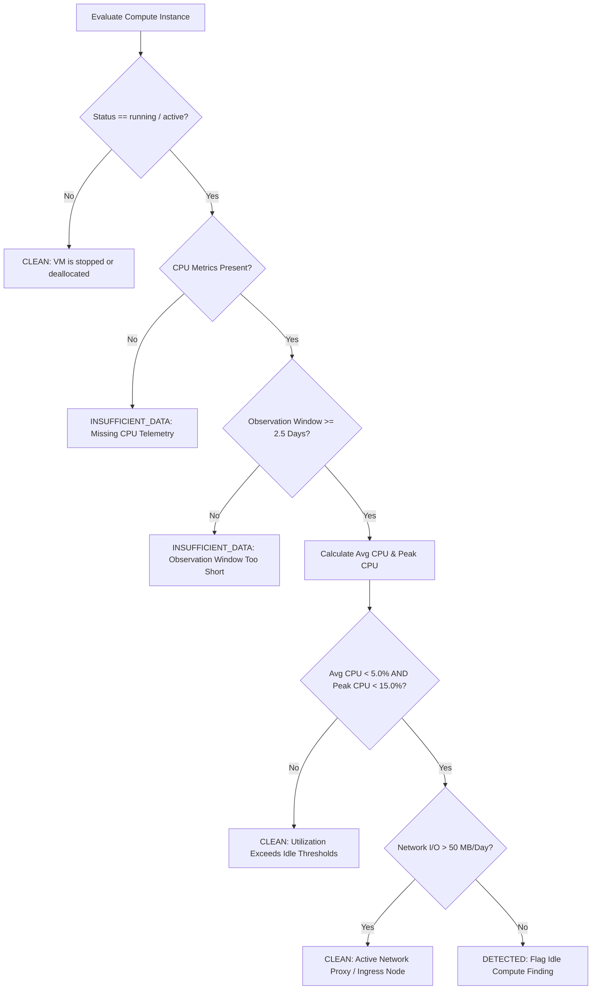

# CloudSage Idle Compute Detection Specification

## 1. Overview & Problem Definition

In enterprise multi-cloud environments, compute instances frequently become idle due to:
1. Abandoned test, staging, or proof-of-concept instances.
2. Completed batch processing jobs that failed to shut down worker nodes.
3. Over-provisioned auto-scaling groups with high minimum instance counts.
4. Legacy monolithic workloads running redundant standby instances.

Because cloud hyperscalers bill compute resources on an hourly or per-second basis while in a `running` state regardless of actual utilization, idle virtual machines represent between 20% and 40% of all identifiable cloud waste.

---

## 2. Multi-Cloud Normalization

CloudSage supports compute instances across all three primary providers through canonical normalization:

| Hyperscaler | Native Resource Identifier | Normalized Asset Type | Default CPU Metric | Default Network Metric |
| :--- | :--- | :--- | :--- | :--- |
| **AWS** | `i-xxxxxxxxxxxxxxxxx` (ARN) | `ec2:instance` | `CPUUtilization` (%) | `NetworkIn` / `NetworkOut` (Bytes) |
| **Azure** | `/subscriptions/.../virtualMachines/...` | `Microsoft.Compute/virtualMachines` | `Percentage CPU` (%) | `Network In Total` / `Network Out Total` |
| **GCP** | `projects/.../zones/.../instances/...` | `compute.googleapis.com/Instance` | `compute.googleapis.com/instance/cpu/utilization` | `instance/network/received_bytes_count` |

---

## 3. Heuristic Decision Engine

---

## 4. Conflicting Signal Safeguards

A critical failure mode of naive cost tools is flagging low-CPU network appliances (e.g., reverse proxies, HAProxy, Envoy, NAT gateways, VPN concentrators, Bastion hosts). These systems route significant traffic without consuming measurable CPU cycles.

CloudSage enforces a strict network traffic safeguard:
- If an instance exhibits $\text{Avg CPU} < 5\%$, but its average network transmission exceeds $50.0\text{ MB/day}$, it is classified as an active networking node and returns `CLEAN`.

---

## 5. Confidence Score Formulation

The confidence score ($C \in [0.1000, 1.0000]$) is computed as a weighted composite:

$$C = (w_{\text{samples}} \times S_{\text{depth}}) + (w_{\text{dimensions}} \times S_{\text{dim}}) + (w_{\text{inventory}} \times S_{\text{inv}})$$

Where:
- $w_{\text{samples}} = 0.40$: Sample depth ($S_{\text{depth}} = \min(1.0, \frac{\text{total\_samples}}{\text{required\_days} \times 24})$)
- $w_{\text{dimensions}} = 0.30$: Multidimensionality ($0.50$ base CPU, $+0.30$ network, $+0.20$ memory)
- $w_{\text{inventory}} = 0.30$: Inventory certainty ($1.0$ if `CONFIRMED`, $0.70$ if `BILLING_INFERRED`)
