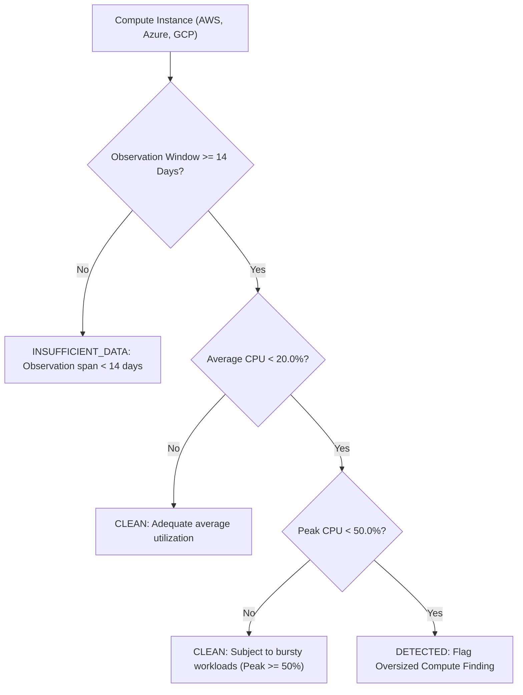

# CloudSage Oversized Resource Detection & Rightsizing Specification

## 1. Overview & Rightsizing Methodology

Cloud computing allows instant resource provisioning, but engineers frequently over-provision instance sizes (e.g., choosing `c5.4xlarge` when `c5.xlarge` would suffice) to avoid performance troubleshooting.

CloudSage identifies compute resources whose operational metrics indicate consistent over-allocation over a continuous 14-day observation window.

---

## 2. Detection Criteria

- **Average CPU Threshold**: $< 20.0\%$ over 14 continuous days.
- **Peak CPU Threshold**: $< 50.0\%$ over 14 continuous days. Instances exhibiting peak utilization $\ge 50.0\%$ are safeguarded from rightsizing recommendations to prevent performance degradation during peak business hours.

---

## 3. Conservative Savings Estimation

Unlike aggressive tools that suggest multi-tier downscaling or cross-family migrations (which risk memory exhaustion or incompatible CPU instruction sets), CloudSage applies a **conservative single-tier downsize policy**:

$$\text{Estimated Monthly Savings} = \text{monthly\_cost} \times 0.50$$

- **Exact Decimal Arithmetic**:
  $$\text{downsize\_ratio} = \text{Decimal}('0.50')$$
  $$\text{savings} = (\text{resource.monthly\_cost} \times \text{downsize\_ratio}).\text{quantize}(\text{Decimal}('0.0001'))$$
- **Non-Speculative Rule**: If an instance has no recorded compute ledger spend ($\text{monthly\_cost} \le \$0.00$), savings estimate is strictly $\$0.0000$.
