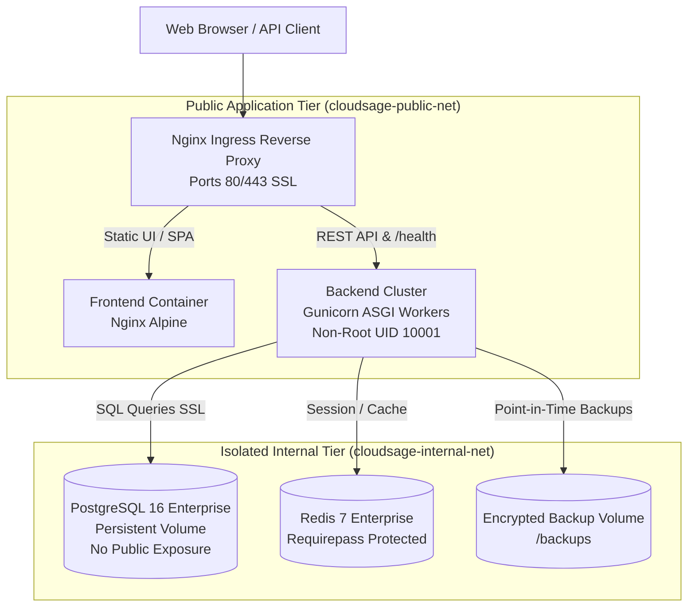

# CloudSage Production Deployment Guide

## 1. Production Architecture Overview

In a production environment, CloudSage is structured into an isolated multi-tier topology:



---

## 2. Security Baseline & Hardening Requirements

Before promoting CloudSage to production, verify the following configuration flags in your secrets manager:

| Setting | Required Value | Rationale |
| :--- | :--- | :--- |
| `ENVIRONMENT` | `production` | Enforces production validation in `Settings`. |
| `SECRET_KEY` | $\ge 32$ high-entropy chars | Generated with `openssl rand -hex 32`. Rejects default key. |
| `ALLOW_DEV_AUTH_HEADERS` | `false` | Disables `X-User-Role` test headers; mandates signed JWTs. |
| `POSTGRES_PASSWORD` | Cryptographically secure | Rejects default password `postgres`. |
| `DATABASE_URL` | SSL enabled (`?ssl=require`) | Encrypts in-transit database communications. |
| `REDIS_PASSWORD` | Strong password | Enforces Redis authentication via `requirepass`. |
| `NOTIFICATION_SAFE_LOCAL_MODE`| `false` | Enables live SMTP/Webhook dispatch. |
| `LOG_FORMAT` | `json` | Structured JSON logging for ELK/Datadog. |

---

## 3. Deployment Methods

### Option A: Production Docker Compose (`docker-compose.prod.yml`)

```bash
# 1. Create production environment file from template
cp .env.production.example .env.production

# 2. Populate production credentials
# (Configure POSTGRES_PASSWORD, SECRET_KEY, REDIS_PASSWORD)

# 3. Pull and launch hardened production stack
docker compose -f docker-compose.prod.yml --env-file .env.production up -d --build

# 4. Verify healthy deployment
docker compose -f docker-compose.prod.yml ps
```

### Option B: Kubernetes Deployment

For Kubernetes environments (EKS, GKE, AKS):
1. **ConfigMaps & Secrets:** Inject settings as Kubernetes `Secret` resources.
2. **Probes Configuration:**
   ```yaml
   livenessProbe:
     httpGet:
       path: /health/liveness
       port: 8000
     initialDelaySeconds: 15
     periodSeconds: 20
   readinessProbe:
     httpGet:
       path: /health/readiness
       port: 8000
     initialDelaySeconds: 10
     periodSeconds: 10
   ```
3. **Security Context:**
   ```yaml
   securityContext:
     runAsUser: 10001
     runAsGroup: 10001
     runAsNonRoot: true
     readOnlyRootFilesystem: false
     allowPrivilegeEscalation: false
   ```

---

## 4. Zero-Downtime Rolling Upgrades & Rollbacks

1. **Pre-Deployment Backup:**
   Execute a point-in-time snapshot before any migration:
   ```bash
   docker compose -f docker-compose.prod.yml exec backend /app/scripts/backup_db.sh
   ```
2. **Rolling Update:**
   Deploy new container images sequentially using rolling updates.
3. **Automated Rollback:**
   If post-deployment health probes (`/health/dependencies`) report degradation or failure, the automated CD workflow rolls back the image tags and preserves the snapshot.

