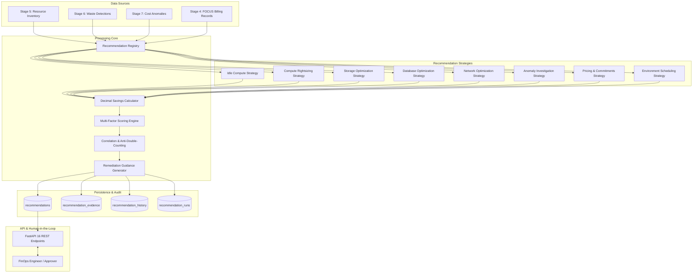

# CloudSage Advisory FinOps Recommendation Engine Architecture

## 1. Executive Summary

The **Advisory FinOps Recommendation Engine** represents Stage 8 of CloudSage's 15-stage architecture. It is responsible for ingesting evidence from:
- **Stage 5**: Multi-Cloud Resource Inventory & Topology
- **Stage 6**: Multi-Cloud Waste Detection Findings
- **Stage 7**: Statistical & Time-Series Cost Anomalies
- **Stage 4**: FOCUS 1.0 Normalized Multi-Cloud Billing Records

The engine synthesizes these cross-stage signals into prioritized, financially quantified, evidence-backed, and human-in-the-loop optimization recommendations across **Amazon Web Services (AWS)**, **Microsoft Azure**, and **Google Cloud Platform (GCP)**.

---

## 2. Strict Advisory-Only Policy

CloudSage enforces a non-negotiable **Advisory-Only Safety Policy**:
1. **Zero Resource Modification**: CloudSage does not possess mutating IAM permissions (`ec2:StopInstances`, `ec2:TerminateInstances`, `az vm delete`, `compute.instances.delete`).
2. **Human-in-the-Loop Review**: No recommendation may be implemented automatically. Every change requires formal engineering evaluation, change approval, and manual or CI/CD execution.
3. **Mandatory Advisory Disclaimers**: Every generated recommendation, CLI snippet, and Terraform script contains an explicit advisory disclaimer highlighting that automated remediation is disabled by design.

---

## 3. High-Level Architecture Components

The Recommendation Engine consists of eight modular components located in `backend/app/recommendations/`:

| Module | File | Primary Responsibility |
| :--- | :--- | :--- |
| **Data Models** | `models.py` | Internal dataclasses (`RecommendationCandidate`, `EvidenceLink`, `ScoringBreakdown`, `StrategyResult`). |
| **Strategy Base** | `base.py` | Abstract `BaseRecommendationStrategy` defining required metadata and `evaluate()` lifecycle. |
| **Strategy Registry** | `registry.py` | Singleton registry holding active heuristics, discovery, and provider filtering. |
| **Savings Calculator** | `savings.py` | Pure `Decimal` arithmetic implementing rightsizing delta, termination, scheduling fractions, tiering discounts, and commitment modeling. |
| **Scoring Engine** | `scoring.py` | Multi-factor prioritization algorithm combining financial impact, evidence confidence, implementation effort, and operational risk. |
| **Guidance Generator** | `guidance.py` | Vendor-specific CLI commands (AWS CLI, Azure CLI, gcloud), Terraform HCL snippets, and rollback steps. |
| **Correlation & Anti-Double-Counting** | `correlation.py` | Deduplication key hashing and action hierarchy resolution preventing double-counting savings on the same resource. |
| **Lifecycle Manager** | `lifecycle.py` | Formal state machine (`PROPOSED`, `UNDER_REVIEW`, `ENDORSED`, `APPROVED`, `IN_PROGRESS`, `IMPLEMENTED`, `VERIFIED`, `REJECTED`, `DISMISSED`, `EXPIRED`, `REOPENED`). |
| **Orchestration Engine** | `engine.py` | Batch run execution, database upserting, summary statistics, financial impact KPIs, and export. |
| **Background Tasks** | `tasks.py` | Celery asynchronous worker integration with synchronous fallback. |
| **Synthetic Generator** | `synthetic.py` | 20 multi-cloud benchmark scenarios for AWS, Azure, and GCP. |

---

## 4. Execution Workflow

1. **Triggering**: A run is triggered via `POST /api/v1/recommendations/run` or scheduled Celery task.
2. **Strategy Evaluation**: The registry dispatches eligible strategies based on scope and provider.
3. **Candidate Synthesis**: Each strategy queries waste detections, anomalies, inventory, and billing records to generate `RecommendationCandidate` objects.
4. **Anti-Double-Counting**: The correlation engine identifies multiple candidates targeting the same cloud resource, applies action precedence (e.g., `TERMINATE` > `RIGHTSIZE` > `SCHEDULE_SHUTDOWN`), and suppresses redundant proposals.
5. **Database Persistence**: Candidates are upserted into the `recommendations` table using deterministic SHA-256 keys. Evidence items and initial history audit entries are inserted.
6. **Run Audit Logging**: Execution metrics, evaluated resource counts, created/updated counts, suppressed records, and total savings are committed to `recommendation_runs`.
