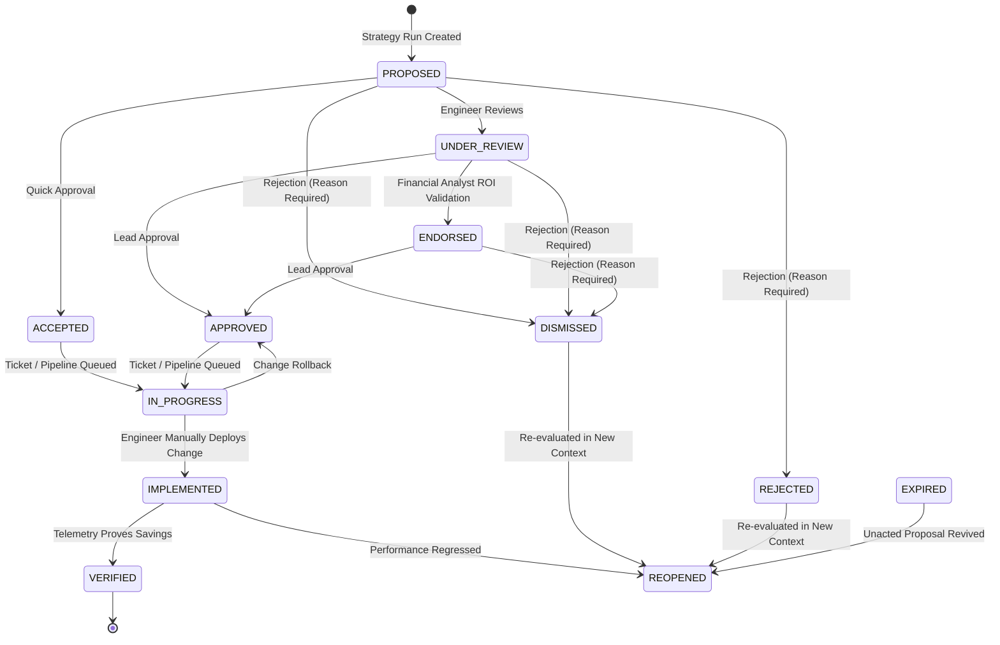

# CloudSage Recommendation Lifecycle Management

## 1. Lifecycle State Machine

CloudSage enforces a strict, auditable state machine for optimization recommendations, reflecting enterprise human-in-the-loop review workflows.

---

## 2. Supported Lifecycle States

| State | Enum Value | Description |
| :--- | :--- | :--- |
| **Proposed / New** | `PROPOSED`, `NEW` | Initial proposal generated by a recommendation strategy; unreviewed. |
| **Under Review** | `UNDER_REVIEW` | Assigned to an engineering team or FinOps analyst for technical evaluation. |
| **Endorsed** | `ENDORSED` | Validated by a Financial Analyst confirming positive ROI and budget impact. |
| **Approved / Accepted**| `APPROVED`, `ACCEPTED`| Formally approved by an Engineering Lead or FinOps Director. |
| **In Progress** | `IN_PROGRESS` | Implementation change ticket queued or active in CI/CD / Terraform pipeline. |
| **Implemented** | `IMPLEMENTED` | Resource modification, resizing, or deletion completed manually in cloud console or Terraform. |
| **Verified** | `VERIFIED` | Subsequent billing cycle confirms realized monthly cost reduction matches or exceeds projection. |
| **Dismissed / Rejected**| `DISMISSED`, `REJECTED`| Recommendation rejected by reviewer. Mandatory justification required. |
| **Expired** | `EXPIRED` | Unreviewed recommendation whose underlying resource state was updated or observation window expired. |
| **Reopened** | `REOPENED` | Previously dismissed recommendation reopened due to renewed waste detection or engineer appeal. |

---

## 3. Mandatory Rejection Justification

To ensure accountability and prevent frivolous dismissals, transitioning a recommendation to `DISMISSED` or `REJECTED` requires a non-empty `reason` parameter. The API returns HTTP `422 Unprocessable Entity` if justification is omitted.

Common documented reasons include:
- *"Instance is dedicated to disaster recovery failover."*
- *"Workload is scheduled for quarterly batch processing next week."*
- *"Architectural rewrite in progress; resource will be replaced by serverless containers."*

---

## 4. Audit History Tracking

Every state transition automatically appends an immutable record to the `recommendation_history` table capturing:
- `recommendation_id`: Foreign key to target recommendation.
- `from_status`: Pre-transition state.
- `to_status`: Post-transition state.
- `actor`: User email or service identity making the change.
- `action`: Audit action label (`APPROVED`, `ENDORSED`, `REJECTED`, `IMPLEMENTED`, `VERIFIED`).
- `notes`: Reviewer explanation or implementation ticket reference.
- `created_at`: Exact UTC timestamp.
