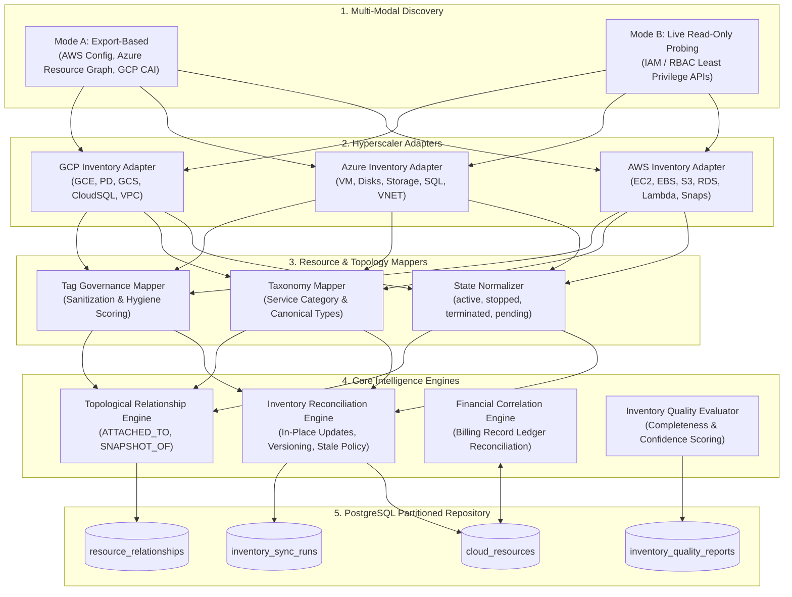

# Multi-Cloud Resource Inventory & Intelligence Architecture

## 1. Executive Summary

CloudSage's **Resource Discovery & Inventory Intelligence Layer** provides an enterprise-grade, authoritative asset graph across **Amazon Web Services (AWS)**, **Microsoft Azure**, and **Google Cloud Platform (GCP)**. It serves as the physical backbone for cloud financial operations (FinOps), bridging low-level infrastructure telemetry with financial billing ledgers and FOCUS™ 1.0 charge models.

---

## 2. Architecture Principles

1. **Dual Discovery Modes**:
   - **Mode A (Export-Based)**: Ingests structured JSON/CSV snapshots exported by native discovery services (e.g. AWS Config, Azure Resource Graph query exports, GCP Cloud Asset Inventory).
   - **Mode B (Live Read-Only Probing)**: Direct API integration querying control plane endpoints with strict read-only least-privilege credentials (`Describe*`, `Get*`, `List*`).
2. **Strict Advisory-Only Execution**:
   - CloudSage does not delete, resize, deallocate, or mutate production infrastructure under any circumstance.
   - Resource lifecycle tracking is observational and advisory.
3. **Non-Destructive Reconciliation**:
   - Missing resources are never deleted from PostgreSQL. A missing resource transitions to `STALE` status after a 14-day grace period, preserving historical billing ties and audit trails.
4. **Zero-Float Financial Precision**:
   - All monetary amounts, metrics, and quality scores strictly use `Decimal` and PostgreSQL `Numeric(18, 4)` / `Numeric(5, 2)` types.

---

## 3. Data Entities & Schema Topology

The inventory subsystem consists of 4 tightly integrated database entities:

| Table Name | Primary Key | Description | Key Indexes / Constraints |
|:---|:---|:---|:---|
| `cloud_resources` | `resource_id` (String 512) | Authoritative multi-cloud asset registry. | `idx_res_prov_env`, `idx_res_owner`, `idx_res_prov_status` |
| `resource_relationships` | `id` (UUID) | Directional topology associations between assets. | `uq_resource_relationships (source, target, type)`, `idx_rel_src_tgt` |
| `inventory_sync_runs` | `run_id` (UUID) | Audit log of import and live discovery runs. | `idx_inv_sync_prov_status`, `idx_inv_sync_started` |
| `inventory_quality_reports` | `report_id` (UUID) | Periodic or on-demand data hygiene snapshots. | `idx_inv_qual_prov_created` |

---

## 4. Pipeline Execution Lifecycle

1. **Intake & Format Detection**:
   The `InventoryRegistry` inspects payloads to detect hyperscaler format from key signatures (`arn:aws:`, `/subscriptions/`, `//compute.googleapis.com`).
2. **Adapter Parsing**:
   Hyperscaler adapters transform raw exports into standardized `DiscoveredResource` and `DiscoveredRelationship` instances.
3. **Tag Governance**:
   Sanitizes prefixes (`tag:`, `user:`), normalizes keys to lowercase, and calculates the 0–100 tag quality score.
4. **Reconciliation**:
   Matches incoming assets against `cloud_resources`. If found, updates attributes in place while preserving `first_discovered_at`. If missing for >14 days, marks `STALE`.
5. **Topological Ingestion**:
   Persists verified directional relationships (e.g. EC2 `ATTACHED_TO` EBS).
6. **Financial Cost Sync**:
   Aggregates the trailing 30-day unblended billing cost from FOCUS 1.0 records into `CloudResource.monthly_cost`.
7. **Quality Audit**:
   Computes completeness, tag coverage, and inventory confidence scores.
