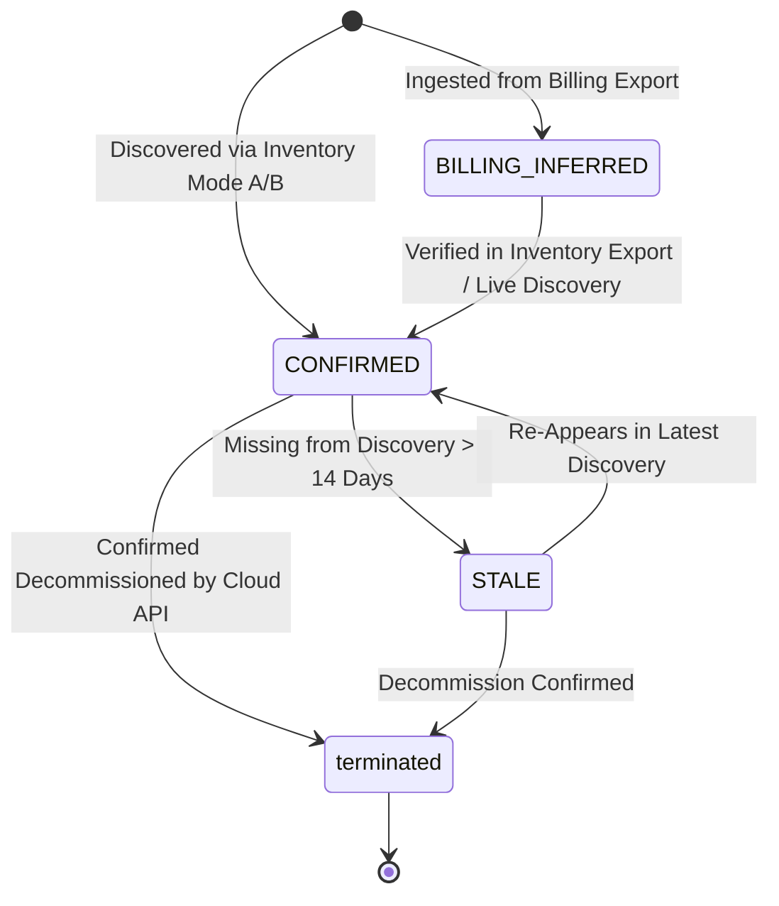

# Multi-Cloud Resource Reconciliation Engine

## 1. Overview & Objectives

The `InventoryReconciliationEngine` synchronizes physical infrastructure discovered via Mode A (file exports) or Mode B (live discovery) with the persistent `cloud_resources` table.

It resolves three fundamental challenges:
1. **Idempotency**: Repeatedly importing identical or overlapping snapshots causes zero duplicate rows.
2. **Audit Preservation**: Initial discovery timestamps (`first_discovered_at`) and historical billing links are never destroyed.
3. **Ghost / Stale Asset Detection**: Infrastructure decommissioned in the cloud is reliably identified without issuing destructive database deletions.

---

## 2. State Transition Lifecycle

### Discovery Status Definitions
- `CONFIRMED`: Actively observed in recent inventory discovery runs.
- `BILLING_INFERRED`: Discovered solely through financial billing line items; awaiting physical inventory verification.
- `STALE`: Previously confirmed in inventory, but missing from recent scans for longer than the configured threshold (default 14 days).
- `UNRECONCILED`: Data anomalies requiring administrator investigation.

---

## 3. Reconciliation Logic & Rules

### Match Criteria
Resources match strictly on `resource_id` (globally unique ARN, ARM URI, or GCP selfLink).

### In-Place Update Rules
When an existing resource is re-discovered:
- `resource_name`: Updated if new non-empty name is provided.
- `status`: Synchronized to canonical lifecycle state (`active`, `stopped`, `terminated`, `deleted`, `pending`).
- `region` & `zone`: Updated to reflect current placement.
- `tags` & `raw_tags`: Updated with newly sanitized key-values.
- `tag_quality_score`: Recalculated against the 5 canonical dimensions.
- `first_discovered_at`: **STRICTLY IMMUTABLE**. Preserved for enterprise audit trails.
- `last_seen_at`: Set to current timestamp.
- `last_inventory_sync_at`: Set to current timestamp.
- `metadata_version`: Incremented (e.g. `1.0` -> `1.1`).
- `discovery_status`: Transitioned from `BILLING_INFERRED` or `STALE` to `CONFIRMED`.

### Stale Asset Policy (Zero Deletions)
When an inventory discovery run executes for a specific cloud provider:
1. The engine tracks all `discovered_ids` observed in the current snapshot.
2. Assets belonging to that provider where `discovery_status == 'CONFIRMED'` but `resource_id NOT IN discovered_ids` are evaluated.
3. If `last_inventory_sync_at < (now - 14 days)`:
   - Status transitions to `STALE`.
   - Resource is tagged for waste detection in Stage 6 (orphan/abandoned resource analysis).
   - **No DELETE statement is ever issued.**
