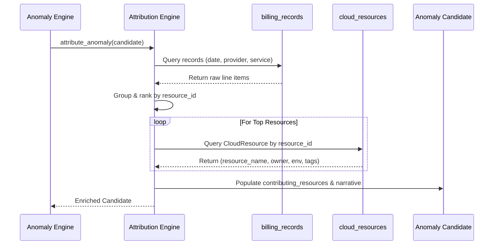

# Root-Cause Attribution & Inventory Correlation

## 1. Overview

Detecting that cloud spend increased is only half the problem; engineers need to know **what caused it, who owns it, and how to fix it**.

The **Root-Cause Attribution Engine** (`backend/app/anomaly_detection/attribution.py`) correlates aggregate anomaly findings with granular line items and Stage 5 `CloudResource` inventory items, generating factual, human-readable FinOps explanations.

---

## 2. Contributor Ranking Analysis

When an anomaly candidate is identified (e.g. at the service, account, or provider level), the attribution engine queries all underlying `BillingRecord` rows for that specific anomaly date:

1. **Resource Aggregation**:
   Groups all billing line items by `resource_id` and sums positive costs:
   $$\text{Share Percentage}_r = \left(\frac{\text{Cost}_r}{\text{Total Anomalous Cost}}\right) \times 100$$
2. **SKU Breakdown**:
   Groups all billing line items by `pricing_model` / SKU to identify specific billing drivers (e.g. provisioned IOPS vs data transfer vs compute hours).
3. **Region Breakdown**:
   Identifies geographical spend distribution to detect cross-region leaks or unauthorized regional launches.
4. **Dominance Evaluation**:
   - If the top resource accounts for $\ge 20.0\%$ of total spend, attribution is confirmed (`status: "ATTRIBUTED"`).
   - If spend is fragmented evenly across hundreds of resources with no resource exceeding $20.0\%$, the engine avoids false finger-pointing and flags `status: "ROOT_CAUSE_UNKNOWN"`.

---

## 3. Stage 5 Inventory Correlation

For top ranked contributing resources, the engine performs a direct join against PostgreSQL `cloud_resources`:

### Enriched Metadata Fields
- `resource_name`: Human-readable name or VM hostname.
- `resource_type`: Cloud asset type (e.g. `ec2:instance`, `dynamodb:table`, `storageAccounts`).
- `owner`: Resource owner extracted from tags (`owner`, `created_by`).
- `environment`: Deployment tier (`production`, `staging`, `dev`).
- `project` & `cost_center`: Financial chargeback center and project ID.
- `status`: Resource operational status (`active`, `stopped`, `terminated`).

---

## 4. Factual Narrative Generation

CloudSage strictly enforces a **non-hallucinatory narrative policy**. Explanations are constructed deterministically from verified database records:

### Attributed Finding Example
> *"On 2026-10-15, AWS AmazonDynamoDB daily expenditure reached $1,000.00, increasing 400.0% above the expected baseline of $200.00 (excess spend of $800.00). Primary contributing resource was 'OrderEventsTable' (arn:aws:dynamodb:us-east-1:123456789012:table/OrderEvents) in 'production' environment (owner: payments-lead@company.com), accounting for 80.0% ($800.00) of anomalous spend. Dominant SKU was 'TimedThroughput-WriteCapacity' contributing 85.0% ($850.00) of expenditure. FinOps recommendation: Inspect recent deployment logs, auto-scaling configurations, and provisioned capacity allocations for the identified resource and service."*

### Inconclusive Finding Example (`ROOT_CAUSE_UNKNOWN`)
> *"On 2026-10-16, AWS AmazonS3 daily expenditure reached $500.00, representing a 400.0% increase over the expected baseline of $100.00 (excess cost: $400.00). Root cause inconclusive across individual resources; spend was distributed across multiple resources or SKUs without a dominant single contributor."*

