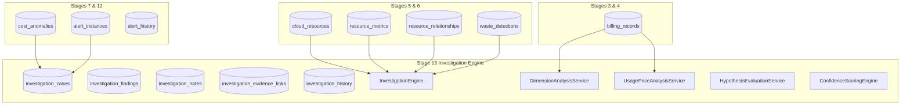

# CloudSage Stage 13 Architectural Audit Report
## Advanced Anomaly Investigation & Multi-Dimensional Root Cause Analysis

**Audit Date:** 2026-11-08  
**Base Branch:** `stage-12/cost-anomaly-alerts-notification-hub`  
**Base Commit:** `711c65a`  
**New Feature Branch:** `stage-13/advanced-anomaly-investigation`  
**Author:** Senior Cloud FinOps Architect & Backend Engineer

---

## 1. Executive Summary & Audit Scope

Prior to commencing implementation of Stage 13 (**Advanced Anomaly Investigation & Multi-Dimensional Root Cause Analysis Workspace**), a mandatory architectural audit of CloudSage was executed across all existing backend services, database models, Alembic migrations, frontend routes, security controls, and test suites.

### Audit Findings:
1. **Repository Health**: The repository is on base commit `711c65a` with all 384 baseline automated tests passing (0 failures, 0 regressions, 100% pass rate).
2. **Existing Root-Cause Attribution Capabilities (Stage 7)**:
   - `backend/app/anomaly_detection/attribution.py` contains a foundational attribution prototype (`attribute_anomaly`) that ranks contributing resources and SKUs for a single calendar day.
   - *Gaps Identified*: It lacks multi-dimensional decomposition across the 10 enterprise dimensions (Provider, Account, Region, Service, Resource, SKU, Environment, Owner, Cost Center, Tags). It does not perform usage vs. pricing decomposition, lacks historical time-series baseline comparison, does not support persistent case management (investigations, assignments, notes, verified findings vs. hypotheses), and provides no dedicated interactive workspace.
3. **Billing Normalization (Stage 4)**:
   - `BillingRecord` (`backend/app/models/billing.py`) provides canonical FOCUS 1.0 fields: `unblended_cost`, `usage_quantity`, `usage_unit`, `pricing_model`, `service_category`, `service_name`, `resource_id`, `region`, `subscription_id`, and `tags`.
   - *Finding*: `BillingRecord` has all required fields to compute usage vs. unit price deviations ($\Delta \text{Cost} = \Delta \text{Usage} \times P_0 + \Delta \text{Price} \times Q_0 + \Delta \text{Usage} \times \Delta \text{Price}$).
4. **Inventory & Topology Intelligence (Stage 5)**:
   - `CloudResource` (`backend/app/models/resource.py`), `ResourceMetric`, and `ResourceRelationship` (`backend/app/models/inventory.py`) provide complete resource metadata, owner/environment/cost-center tags, time-series metrics (CPU, Memory, Network), and dependency topology.
5. **Cross-Signal Entities (Stages 6, 8, 11, 12)**:
   - `WasteDetection` (Stage 6), `Recommendation` (Stage 8), and `AlertInstance` / `AlertHistory` (Stage 12) exist and can be correlated with anomalies without data duplication.
   - `CorrelationService` (`backend/app/services/correlation.py`) already correlates resources with waste, recommendations, and billing records; this will be extended for investigation workspaces.
6. **Security & Identity Governance (Stage 12)**:
   - `get_authenticated_principal` in `backend/app/alerts/security.py` successfully derives caller identity from Authorization tokens and gateway headers. Client-supplied actor strings are strictly rejected.
   - SSRF protection in `validate_webhook_url` blocks loopbacks (`127.0.0.0/8`, `::1`), RFC 1918 private subnets (`10.0.0.0/8`, `172.16.0.0/12`, `192.168.0.0/16`), and cloud metadata (`169.254.169.254`).
7. **Database Migration Lineage**:
   - The Alembic sequence is cleanly established through `010_cost_anomaly_alerts_hub.py`.
   - Stage 13 will introduce `011_advanced_anomaly_investigation.py` extending the schema with investigation cases, findings, notes, evidence links, and state history.

---

## 2. Inventory of Existing Subsystems & Reusable Assets

### Subsystem Audit Matrix:

| Subsystem | Location | Existing State | Stage 13 Reusability / Extension |
| :--- | :--- | :--- | :--- |
| **Anomaly Models** | `backend/app/models/anomaly.py` | Complete (`CostAnomaly`) | Reused directly; linked via foreign key to `investigation_cases`. |
| **Statistical Attribution** | `backend/app/anomaly_detection/attribution.py` | Prototype ranking | Extracted into modular `backend/app/investigation/` package. |
| **FOCUS Billing** | `backend/app/models/billing.py` | Canonical schema | Queried for 10-dimensional decomposition and usage-vs-price math. |
| **Cloud Resource Inventory** | `backend/app/models/resource.py` | Complete inventory & metrics | Queried for resource attribution, ownership, and utilization signals. |
| **Resource Relationships** | `backend/app/models/inventory.py` | Complete topology | Queried to trace dependent resources (e.g. EC2 instance $\rightarrow$ EBS volume). |
| **Waste Detections** | `backend/app/models/waste.py` | Stage 6 detections | Correlated to identify whether anomaly coincides with known waste. |
| **Recommendations** | `backend/app/models/recommendation.py` | Stage 8 recommendations | Correlated to verify if an optimization action was already pending. |
| **Alert Instances** | `backend/app/models/alert.py` | Stage 12 state machine | Correlated to link originating alert notifications and SLA timers. |
| **Security & Principal** | `backend/app/alerts/security.py` | Stage 12 principal resolver | Reused directly across all investigation endpoints (`get_authenticated_principal`). |
| **Correlation Service** | `backend/app/services/correlation.py` | Multi-entity correlation | Extended for investigation case correlation endpoints. |
| **Copilot Assistant** | `backend/app/copilot/` | Stage 9 query engine | Integrated as an investigation assistant grounding responses in case evidence. |

---

## 3. Analysis of Existing Root-Cause Capabilities vs. Gaps

### What is Functional:
- Daily aggregation by resource ID and SKU for an anomaly candidate.
- Calculation of resource cost share percentages.
- Basic narrative generation (`generate_attribution_narrative`) citing primary resource and dominant SKU.
- Association of basic resource metadata (resource name, owner, environment).

### What is Incomplete or Missing:
1. **Multi-Dimensional Decomposition**: No breakdown across the 10 standard FinOps dimensions: Provider, Account, Region, Service, Resource, SKU, Environment, Owner, Cost Center, Tags.
2. **Additive vs. Dimension Consistency**: No clear boundary between additive cost components and multi-dimensional cross-sectional slices, creating double-counting risks in reporting.
3. **Usage vs. Pricing Decomposition**: No mathematical separation between volumetric usage increases ($\Delta Q \cdot P$) and unit pricing/SKU mix increases ($\Delta P \cdot Q$).
4. **Time-Series Baseline Comparison**: No historical window analysis comparing the anomaly date to trailing 7-day, 14-day, and 30-day moving averages and day-of-week patterns.
5. **Investigation Case Management**: No persistent entity to track who is investigating an anomaly, triage findings, assign priorities, record hypotheses, and maintain an immutable investigation audit trail.
6. **Evidence Provenance & Confidence Scoring**: No structured distinction between an *Observed Fact*, a *Statistical Correlation*, a *Suspected Explanation*, and a *Verified Root Cause*. Confidence scores were hardcoded rather than derived from deterministic rules.
7. **Frontend Workspace**: No interactive `/investigations` or `/investigations/:id` route in the React frontend.

---

## 4. Security, Authorization & Tenant Isolation Audit

1. **Authentication Enforcement**:
   - Every investigation operation (create, assign, transition status, add notes, record findings, close, reopen) will use `get_authenticated_principal` to enforce identity server-side.
   - Client-supplied `actor`, `author`, or `owner` fields in JSON request payloads will be strictly rejected.
2. **Account & Tenant Isolation**:
   - Queries must filter by `account_id` / tenant context. Users belonging to Account A must never be permitted to inspect or modify investigations, billing records, or evidence belonging to Account B.
3. **SSRF Protection Audit**:
   - Webhook SSRF validation in `validate_webhook_url` was verified to block `127.0.0.1`, `10.0.0.0/8`, `172.16.0.0/12`, `192.168.0.0/16`, and cloud metadata `169.254.169.254`.
   - Investigation evidence URLs will be strictly validated to prevent external link injection or SSRF attacks.
4. **Zero Mutating Execution Policy**:
   - The investigation engine is strictly analytical and advisory. Zero mutating cloud infrastructure API calls will exist.

---

## 5. Proposed Database Schema Architecture (Migration 011)

Migration `011_advanced_anomaly_investigation.py` will introduce:
1. **`investigation_cases`**:
   - `id`: UUID (Primary Key).
   - `anomaly_id`: UUID (Foreign Key to `cost_anomalies.id`, non-nullable).
   - `alert_instance_id`: UUID (Foreign Key to `alert_instances.id`, nullable).
   - `title`: String(256).
   - `status`: String(32) — `NEW`, `ASSIGNED`, `INVESTIGATING`, `ROOT_CAUSE_IDENTIFIED`, `ACTION_RECOMMENDED`, `RESOLVED`, `CLOSED`.
   - `priority`: String(16) — `CRITICAL`, `HIGH`, `MEDIUM`, `LOW`.
   - `assigned_to`: String(128) (User email or principal ID).
   - `assigned_at`: DateTime(timezone=True).
   - `provider`: String(16).
   - `account_id`: String(64).
   - `service_name`: String(128).
   - `excess_cost`: Numeric(18, 4).
   - `root_cause_summary`: Text (null until identified).
   - `verified_root_cause`: Text (null until verified).
   - `resolution_notes`: Text (mandatory for `RESOLVED`).
   - `created_by`: String(128).
   - `created_at`, `updated_at`, `closed_at`.
2. **`investigation_findings`**:
   - Individual evidence-backed observations, correlations, hypotheses, and verified causes.
   - Fields: `finding_type` (`FACT`, `CORRELATION`, `HYPOTHESIS`, `VERIFIED_CAUSE`), `title`, `explanation`, `financial_impact`, `confidence_category` (`HIGH`, `MEDIUM`, `LOW`, `INSUFFICIENT_EVIDENCE`), `confidence_score` (Numeric 5, 4), `evidence_source`, `evidence_reference`.
3. **`investigation_notes`**:
   - Human collaboration commentary: `content`, `author`, `created_at`.
4. **`investigation_evidence_links`**:
   - M:N links connecting cases to `cloud_resources`, `billing_records`, `waste_detections`, `recommendations`, and `alert_instances`.
5. **`investigation_history`**:
   - Immutable audit trail: `from_status`, `to_status`, `actor`, `action`, `notes`, `created_at`.

---

## 6. Implementation Strategy & Roadmap

With the audit complete and requirements verified, Stage 13 implementation proceeds in 7 phases:
1. **Database Models & Alembic Migration 011**.
2. **Pydantic v2 Schemas** (`backend/app/schemas/investigation.py`).
3. **Advanced Root Cause Analysis Engine** (`backend/app/investigation/`).
4. **REST API Endpoints** (`backend/app/api/routes/investigations.py`).
5. **Interactive React Investigation Workspace** (`frontend/src/pages/`, `frontend/src/components/`, `frontend/src/types/`).
6. **Automated Test Suite** ($\ge 50$ tests covering all modules).
7. **15-Step End-to-End Demonstration Script & Documentation Suite**.
