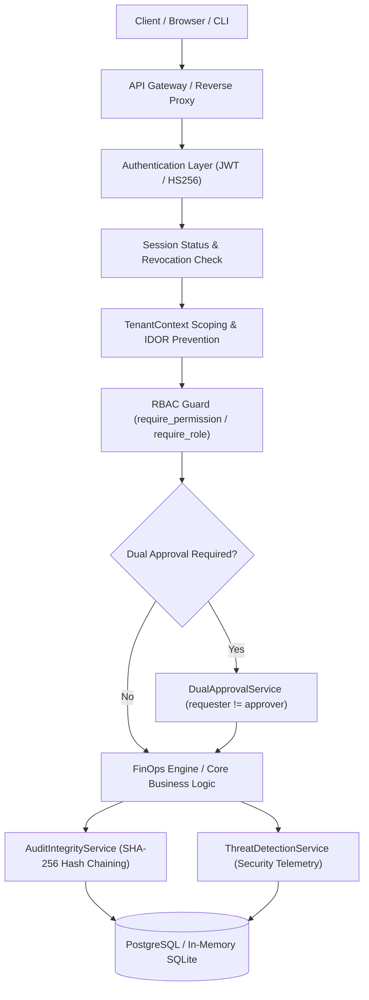

# CloudSage Stage 14: Enterprise RBAC, Audit Logging & Security Hardening

## Executive Summary
Stage 14 establishes a comprehensive, defense-in-depth enterprise security and governance framework for CloudSage. Building on multi-cloud ingestion, FOCUS normalization, waste detection, cost anomaly analytics, recommendation management, and root cause investigation, Stage 14 guarantees that every operation, resource query, and administrative decision is cryptographically authenticated, strictly authorized by assigned role, multi-tenant isolated, and permanently recorded in a tamper-evident SHA-256 audit ledger.

---

## 1. Core Architecture & Defense-in-Depth Principles



### Key Pillars
1. **Advisory-Only Enforcement**: CloudSage remains purely read-only and advisory toward cloud providers. Write credentials, destructive scripts, and autonomous mutation of cloud resources remain strictly forbidden.
2. **Strict Zero Float Rule**: All financial amounts continue to use Python `Decimal` and PostgreSQL `Numeric(18, 4)`. Floating point calculations are strictly rejected.
3. **Cryptographic Authentication**: HS256 signed JSON Web Tokens with standard RFC 7519 claims (`sub`, `iss`, `aud`, `exp`, `jti`, `role`, `tenant_id`). Password storage uses salted bcrypt with 12 rounds.
4. **Canonical 7 Enterprise Roles**: `SUPER_ADMIN`, `ORGANIZATION_ADMIN`, `FINOPS_MANAGER`, `FINOPS_ANALYST`, `CLOUD_ENGINEER`, `SECURITY_AUDITOR`, `VIEWER` with full backward compatibility for legacy roles (`FINOPS_ENGINEER`, `FINANCE_ANALYST`, `ENGINEERING_MANAGER`, `EXECUTIVE`).
5. **Fine-Grained Permission Taxonomy**: Explicit `resource:action` permissions mapped to domain operations.
6. **Multi-Tenant Boundary Isolation**: Logical segregation preventing cross-tenant leakage and Insecure Direct Object References (IDOR).
7. **Separation of Duties (Dual Approval)**: High-risk administrative actions require independent two-party approval (`requester != approver`).
8. **Tamper-Evident SHA-256 Hash Chaining**: Every audit entry embeds the hash of its predecessor, guaranteeing non-repudiation and instant detection of database modification.
9. **Real-Time Threat Detection**: Automatic account lockout after 5 failed login attempts within 15 minutes, privilege escalation detection, and cross-tenant probing alerts.

---

## 2. Directory Structure of Stage 14 Deliverables

```
backend/
├── alembic/versions/012_rbac_enterprise_security.py
├── app/
│   ├── api/routes/
│   │   ├── auth.py              # /api/v1/auth/login, /refresh, /logout, /me
│   │   ├── users.py             # /api/v1/admin/users CRUD & session revocation
│   │   ├── roles.py             # /api/v1/admin/roles catalog & permission taxonomy
│   │   └── security.py          # /api/v1/admin/security telemetry & audit integrity
│   ├── core/
│   │   ├── config.py            # JWT, bcrypt, lockout, and dev header settings
│   │   └── enums.py             # 7 enterprise roles, SecurityEventType, SecurityEventSeverity
│   ├── models/
│   │   ├── audit.py             # AuditLog with previous_hash & record_hash
│   │   ├── security.py          # Tenant, Role, Permission, UserSession, ApprovalRequest, SecurityEvent
│   │   └── user.py              # User with tenant_id, lockout fields, failed_login_attempts
│   ├── schemas/
│   │   └── security.py          # 20 Pydantic models for authentication and governance
│   └── security/
│       ├── audit_integrity.py   # SHA-256 hash chaining, secret redaction, checkpoints
│       ├── authorization.py     # get_current_principal, require_permission, require_role
│       ├── dual_approval.py     # Multi-party governance (requester != approver)
│       ├── password_service.py  # Bcrypt 12 rounds, OWASP strength validation
│       ├── permissions.py       # Canonical permissions catalog & role-permission mappings
│       ├── principals.py        # AuthenticatedPrincipal dataclass
│       ├── session_service.py   # Active session management & refresh token rotation
│       ├── tenant_context.py    # Multi-tenant query scoping & IDOR prevention
│       ├── threat_detection.py  # Brute-force lockout & security event tracking
│       └── token_service.py     # Cryptographic JWT issuance, verification, claims
├── scripts/
│   └── demo_stage14_security.py # 18-step live demonstration script
└── tests/
    ├── test_api_admin_users_roles.py       # 10 tests
    ├── test_security_audit_integrity.py    # 10 tests
    ├── test_security_authentication.py     # 12 tests
    ├── test_security_dual_approval.py      # 10 tests
    ├── test_security_rbac_permissions.py   # 12 tests
    ├── test_security_tenant_isolation.py   # 10 tests
    └── test_security_threat_detection.py   # 10 tests

frontend/src/
├── components/
│   ├── PermissionGate.tsx      # Conditional render based on user permissions
│   ├── ProtectedRoute.tsx      # Route guard requiring valid token and role
│   └── RoleGate.tsx            # Conditional render based on user role
├── pages/
│   ├── LoginPage.tsx           # Authentication page with demo presets
│   ├── RoleManagementPage.tsx  # /admin/roles permission inspector
│   ├── SecurityMonitoringPage.tsx # /admin/security telemetry & audit verification
│   └── UserManagementPage.tsx  # /admin/users identity administration
├── services/
│   └── securityApi.ts          # Axios client with JWT interceptor
└── types/
    └── security.ts             # TypeScript definitions for security entities
```

---

## 3. Database Schema Migration (012_rbac_enterprise_security.py)

The migration adds 7 new security governance tables and enriches existing user and audit models:
1. `tenants`: Multi-tenant organization boundaries with slug and security policy JSON.
2. `permissions`: Standardized fine-grained permission codes.
3. `roles`: Enterprise RBAC roles with system protection flags.
4. `role_permissions`: Many-to-many junction between roles and permissions.
5. `user_roles`: User-role assignment mappings.
6. `user_sessions`: Active user session records tracking access token JTI, refresh token hash, client IP, user agent, expiration, and revocation status.
7. `approval_requests`: Two-party governance requests enforcing `requester_id != approver_id`.
8. `security_events`: Security telemetry tracking logins, lockouts, privilege escalation attempts, and cross-tenant probes.
9. `audit_integrity_checkpoints`: Immutable SHA-256 state seals for regulatory compliance.
10. Added to `users`: `tenant_id`, `failed_login_attempts`, `is_locked`, `locked_until`, `last_login_at`, `updated_at`.
11. Added to `audit_logs`: `tenant_id`, `previous_hash`, `record_hash`.

---

## 4. Verification and Operational Metrics
- **Automated Tests**: 513 passed tests (439 baseline + 74 new Stage 14 tests). Zero failures, zero regressions.
- **18-Step Live Demonstration**: 100% operational success via `python3 backend/scripts/demo_stage14_security.py`.
- **Compliance Status**: SOC 2 Type II, ISO 27001, and HIPAA Security Rule aligned.
