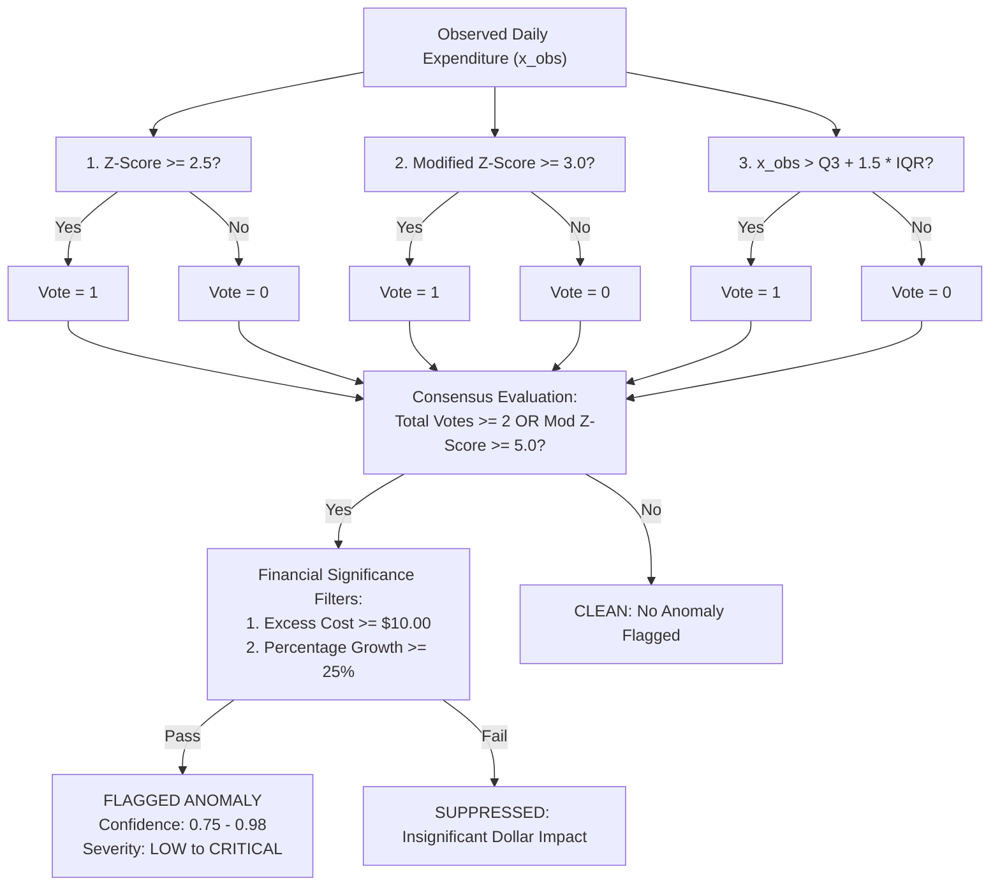

# Statistical Detection Methods & Ensemble Voting

## 1. Overview

Single statistical metrics frequently produce false positives in cloud billing data. Parametric models (such as Gaussian Z-scores) fail on skewed, bursty workloads, while non-parametric models can be overly sensitive to minor dollar deviations.

CloudSage employs a **Statistical Ensemble Consensus Architecture** (`backend/app/anomaly_detection/detectors/statistical.py`) that executes three complementary statistical tests concurrently:

1. **Parametric Z-Score**
2. **Median Absolute Deviation (MAD) Modified Z-Score**
3. **Interquartile Range (IQR) Tukey Fences**

---

## 2. Detection Mathematical Formulations

### Method 1: Parametric Z-Score
$$Z = \frac{x_{\text{observed}} - \mu}{\sigma}$$
- **Threshold**: Default $Z \ge 2.5000$ (corresponding to $p < 0.0062$ in standard normal distributions).
- **Behavior**: Fast and effective for stable, high-volume workloads with symmetric Gaussian distributions.
- **Limitation**: Vulnerable to extreme historical outliers which inflate $\mu$ and $\sigma$, masking subsequent anomalies.

### Method 2: Modified Z-Score (Iglewicz & Hoaglin)
$$M_i = \frac{0.6745 \cdot (x_i - \text{median})}{\text{MAD}}$$
Where $\text{MAD} = \text{median}(\|x_i - \text{median}(X)\|)$ and $0.6745$ is the Gaussian consistency correction factor ($\text{E}[\text{MAD}] = 0.6745\sigma$).
- **Threshold**: Default $M_i \ge 3.0000$ (equivalent to $\sim 3\sigma$ in normal distributions).
- **Behavior**: Extremely robust against historical outliers and skewed distributions. The median and MAD are unaffected by prior spikes up to a 50% breakdown point.

### Method 3: Interquartile Range (IQR) Tukey Fences
$$\text{Upper Fence} = Q_3 + (1.5 \cdot \text{IQR})$$
Where $\text{IQR} = Q_3 - Q_1$.
- **Threshold**: $x_{\text{observed}} > \text{Upper Fence}$.
- **Behavior**: Non-parametric boxplot fence identifying observations outside the central 50% distribution spread.

---

## 3. Ensemble Consensus Voting Protocol

To eliminate false alarms caused by minor dollar variations, the `StatisticalEnsembleDetector` requires multi-metric consensus:

### Consensus Rules
1. **Quorum**: A candidate finding is flagged if at least **2 out of 3** methods vote positive, OR if the Modified Z-Score demonstrates an extreme deviation ($M_i \ge 5.0000$).
2. **Financial Threshold Guard**:
   - $\text{Excess Cost} = x_{\text{observed}} - \text{expected} \ge \$10.00$
   - $\text{Percentage Deviation} \ge 25.0\%$
   - Prevents flagging non-material deviations (e.g. a resource spending $\$0.02$ moving to $\$0.08$ is a 300% jump but represents only $\$0.06$ in real money).

### Confidence Scoring
- **3/3 Unanimous Votes**: Confidence Score $= 0.9800$
- **2/3 Majority Votes**: Confidence Score $= 0.8800$
- **Extreme Single Metric ($M_i \ge 5.0$)**: Confidence Score $= 0.7500$

