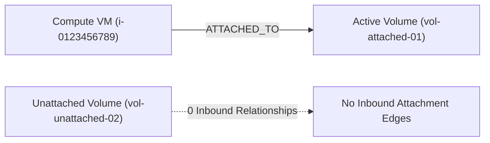

# CloudSage Storage & Snapshot Waste Detection Specification

## 1. Executive Summary

Storage waste accumulates silently in cloud accounts. When a virtual machine is terminated, attached block storage volumes (AWS EBS, Azure Managed Disks, GCP Persistent Disks) frequently persist unless configured with specific delete-on-termination flags. Similarly, manual and scheduled snapshots are created over time without systematic expiration, accumulating recurring gigabyte-month fees indefinitely.

---

## 2. Unattached Block Storage Detection

### 2.1 Supported Volume Types
- **AWS**: Amazon Elastic Block Store (EBS) (`gp2`, `gp3`, `io1`, `io2`, `st1`, `sc1`).
- **Azure**: Azure Managed Disks (Standard HDD, Standard SSD, Premium SSD, Ultra Disk).
- **GCP**: Google Compute Engine Persistent Disks (`pd-standard`, `pd-balanced`, `pd-ssd`, `pd-extreme`).

### 2.2 Topological Relationship Analysis
Rather than relying solely on point-in-time provider status strings, CloudSage utilizes the **Stage 5 Topology Graph**:

- If an inbound relationship `ATTACHED_TO` exists from a compute instance to the volume, the volume is classified as **CLEAN**.
- If zero inbound attachment edges exist and status is `available` or `unattached`, the volume is eligible for waste evaluation.

### 2.3 Unattached Grace Period
To avoid alerting on transient disks (e.g. disks unattached temporarily during snapshotting, offline maintenance, or instance migration), CloudSage enforces a strict **3-day grace period**:
- If $\text{Age} < 3 \text{ days}$, returns `CLEAN`.
- If $\text{Age} \ge 3 \text{ days}$, flagged as `UNATTACHED_STORAGE`.

---

## 3. Orphaned Snapshot Detection

### 3.1 Detection Logic & Conditions
A snapshot is flagged as an orphaned snapshot if and only if **all** of the following conditions are satisfied:
1. Resource classification is `SNAPSHOT`.
2. Snapshot age is $\ge 30 \text{ days}$.
3. Parent volume relationship (`SNAPSHOT_OF`) is missing or confirmed deleted.
4. Snapshot has **NO** compliance or intentional retention tags.

### 3.2 Compliance & Regulatory Preservation Safeguards
CloudSage respects corporate data governance and legal hold policies. Snapshots carrying any of the following tags are automatically excluded and yield `CLEAN`:
- `compliance` (e.g., `compliance: hipaa`, `compliance: sox`)
- `retention` (e.g., `retention: 7-years`)
- `donotdelete` / `do-not-delete`
- `archive`
- `backup_policy`

---

## 4. Financial Calculations

- **Unattached Volume**:
  $$\text{Monthly Savings} = \text{monthly\_cost} \quad (\text{or } \text{size\_gb} \times \$0.08/\text{GB-mo})$$
- **Orphaned Snapshot**:
  $$\text{Monthly Savings} = \text{monthly\_cost} \quad (\text{or } \text{size\_gb} \times \$0.05/\text{GB-mo})$$
