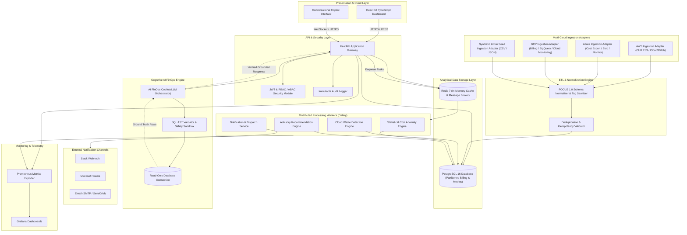
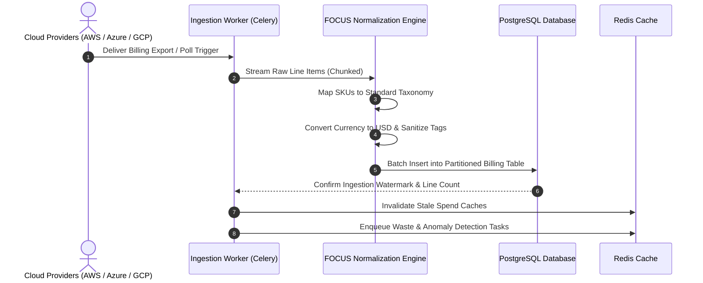
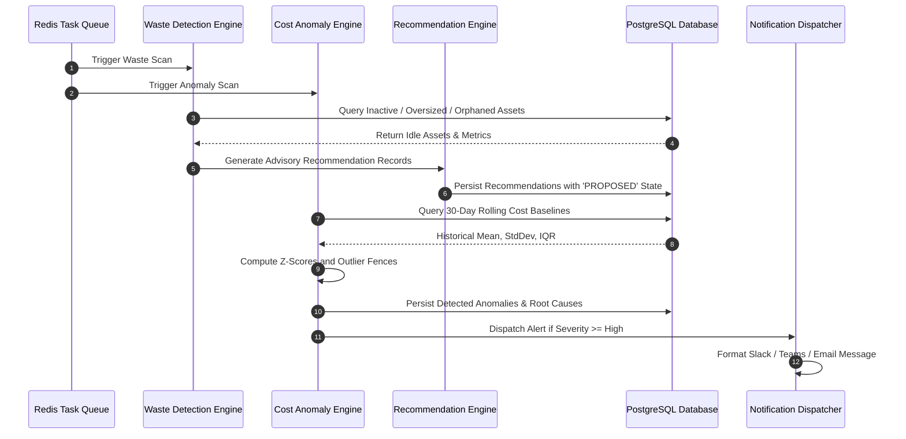
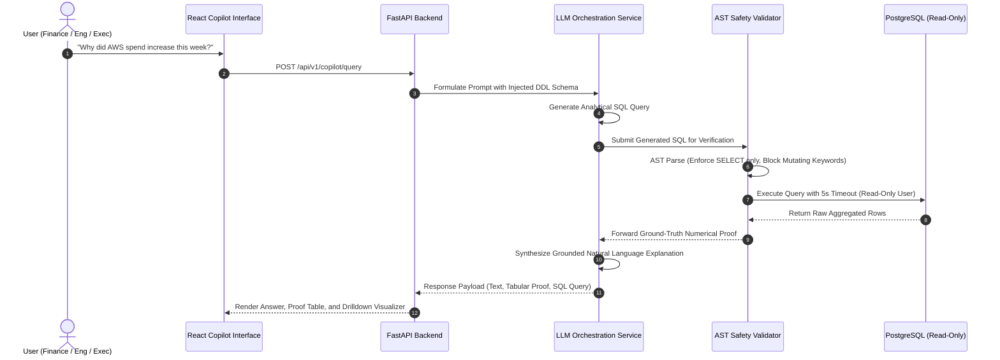
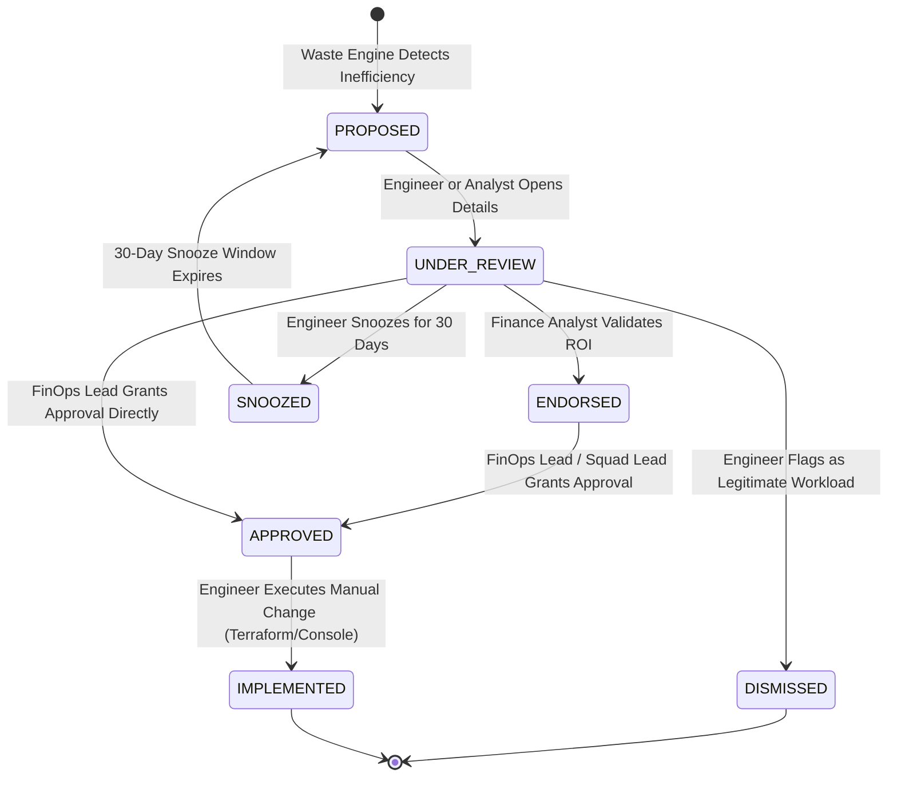

# CloudSage: System Architecture and Data Flow

## 1. Architectural Overview

CloudSage is designed as a distributed, decoupled, service-oriented architecture engineered for high concurrency, deterministic financial accuracy, and multi-cloud scalability.

The system partitions responsibilities cleanly across:
1. **Presentation Layer**: Responsive React/TypeScript client with interactive Recharts visualizations.
2. **API & Gateway Layer**: High-throughput FastAPI application exposing secure REST endpoints, enforcing JWT auth and RBAC/ABAC policies.
3. **Ingestion & Normalization Layer**: Cloud-specific adapters consuming AWS, Azure, and GCP billing feeds, converting them into a canonical FOCUS 1.0 schema.
4. **Analytical Storage Layer**: Partitioned PostgreSQL 16 database storing normalized billing ledgers, telemetry, detection outputs, and audit logs.
5. **Analytical Detection Engines**: Asynchronous Celery workers evaluating deterministic waste heuristics and statistical cost anomaly baselines.
6. **Advisory Recommendation Engine**: Generates prioritized, risk-scored optimization plans with human-in-the-loop governance.
7. **AI FinOps Copilot**: Natural Language to SQL (NL2SQL) engine equipped with schema validation, AST safety parsing, read-only database sandboxing, and deterministic answer grounding.
8. **Notification & Dispatch Service**: Multi-channel notification pipeline publishing alerts to Slack, Teams, Email, and Webhooks.
9. **Observability & Telemetry Infrastructure**: Prometheus metrics harvesting, structured JSON logging, and Grafana dashboard visualization.

---

## 2. High-Level Architecture Diagram

---

## 3. End-to-End Data Flow

The platform executes five primary operational data flows:

### 3.1 Data Flow 1: Ingestion and Normalization Pipeline

1. **Scheduled Trigger**: Celery Beat or cloud webhooks trigger an ingestion job for an active provider account.
2. **Chunked Stream**: Raw billing files (AWS CUR, Azure Cost Export, GCP BigQuery rows) are streamed in 50,000-row chunks.
3. **Standardization**: Provider-specific fields are mapped into the FOCUS 1.0 canonical format (`record_id`, `provider`, `service_category`, `unblended_cost`, `tags`).
4. **Currency & Tag Normalization**: Costs are converted to USD; tags are lowercased and stripped of whitespace; canonical tags (`owner`, `environment`, `project`) are extracted.
5. **Idempotent Upsert**: Batches are written to PostgreSQL using composite uniqueness checks (`provider`, `account_id`, `usage_start_time`, `line_item_id`).
6. **Task Trigger**: Ingestion completion automatically signals the Waste and Anomaly Detection engines.

---

### 3.2 Data Flow 2: Waste and Anomaly Detection Pipeline

1. **Waste Engine Execution**: Runs deterministic heuristics against unified data:
   - Queries instances where average CPU utilization was $< 5\%$ and network I/O $< 5\text{MB/day}$ over 7 days.
   - Queries block storage volumes in `available` (unattached) status for $> 3\text{ days}$.
   - Queries snapshots with age $> 90\text{ days}$ or deleted source volumes.
2. **Recommendation Generation**: Converts detected waste into structured advisory recommendations with projected dollar savings and risk scoring.
3. **Anomaly Engine Execution**: Calculates 30-day rolling baseline metrics ($\mu$, $\sigma$, IQR) per service and account. Detects spending spikes where Z-score $\ge 3.0$ and absolute daily delta $> \$50$.
4. **Root-Cause Attribution**: Identifies the primary cost-driving resource, region, and team tag.
5. **Notification Dispatch**: Dispatches urgent alerts to configured Slack webhooks and email distribution lists.

---

### 3.3 Data Flow 3: AI FinOps Copilot Conversational Query Flow

1. **User Prompt**: The user enters a question in natural language.
2. **Context Assembly**: Backend injects canonical schema definitions and user role-scoping filters.
3. **SQL Generation**: The LLM acts as an expert SQL query generator, producing a precise aggregation query.
4. **AST Safety Guard**: The query is validated using an Abstract Syntax Tree (AST) parser to ensure:
   - Query starts strictly with `SELECT`.
   - Contains no data-modifying statements (`DROP`, `DELETE`, `UPDATE`, `INSERT`, `ALTER`).
   - Restricts row limits (`LIMIT 100`).
5. **Deterministic Execution**: The query is executed on a dedicated read-only database connection.
6. **Grounded Synthesis**: The LLM synthesizes the natural language response using **only** the returned rows, citing exact numbers and displaying the underlying proof table.

---

### 3.4 Data Flow 4: Human-in-the-Loop Recommendation Lifecycle

---

## 4. Security Boundaries and Isolation

- **Zero Ingress to Production Clouds**: CloudSage does not require ingress ports to enterprise virtual private clouds (VPCs). Cloud billing data is pulled securely via HTTPS from cloud storage buckets or BigQuery datasets.
- **Read-Only Credentials**: Cloud integrations operate strictly under read-only IAM policies. The backend cannot create, modify, downscale, or delete any cloud asset.
- **Database Connection Isolation**:
  - `app_writer`: Used by ingestion workers for inserting normalized records.
  - `app_reader`: Used by standard dashboard endpoints.
  - `copilot_sandbox`: Restricted read-only user with explicit execution timeouts and row caps, preventing resource starvation or data exfiltration.
