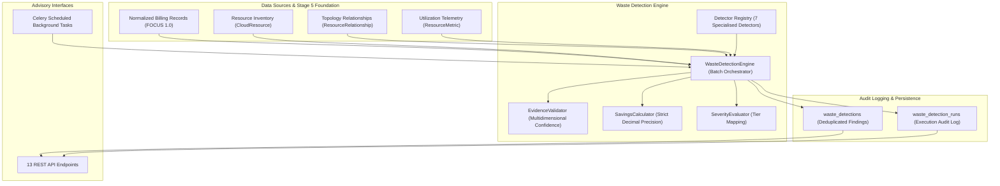
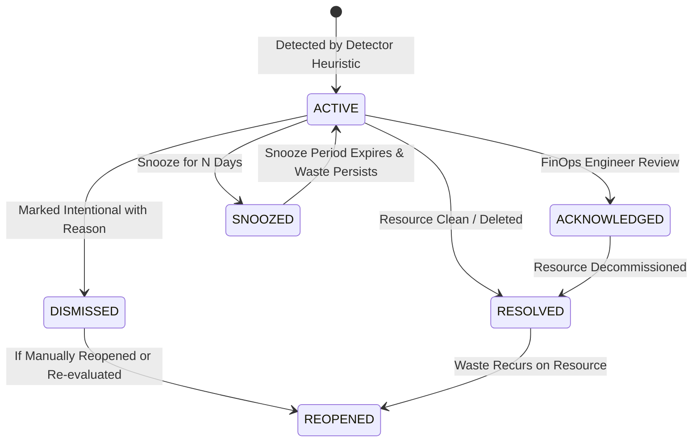

# CloudSage Intelligent Multi-Cloud Waste Detection Architecture

## 1. Executive Summary

The **CloudSage Waste Detection Engine** is an evidence-based, advisory-only financial optimization framework designed to identify unnecessary cloud expenditure across Amazon Web Services (AWS), Microsoft Azure, and Google Cloud Platform (GCP).

Operating on top of normalized FOCUS 1.0 billing records, the unified Stage 5 resource inventory, and continuous time-series utilization telemetry, the engine systematically uncovers idle, oversized, unattached, orphaned, and misconfigured infrastructure without risking service disruptions.



---

## 2. Fundamental Architectural Principles

1. **Strict Advisory-Only Policy**:
   CloudSage generates structured financial insights and actionable recommendations. Under no circumstances does the engine execute automated stops, deletions, detachments, downscaling, or configuration alterations on customer production infrastructure.
2. **Zero Float Rule (Financial Determinism)**:
   All financial metrics, cost reductions, confidence calculations, and thresholds are computed using Python `Decimal` and PostgreSQL `Numeric(18, 4)`. Floating point (`float`) representations are strictly prohibited across all data models and calculations.
3. **Evidence-Based Validation**:
   Findings are never generated from isolated, single-point indicators. Detection requires multi-sample observation windows (e.g. $\ge 7$ or $\ge 14$ days), multi-dimensional telemetry (CPU + Memory + Network), and topological confirmation.
4. **Idempotence & Zero Duplicate Findings**:
   Findings are tracked against `(resource_id, waste_type)`. Re-running detection updates existing records in-place, preventing finding duplication.
5. **Human-in-the-Loop Governance**:
   Reviewers can Acknowledge, Dismiss (with mandatory rationale), or Snooze findings, providing complete organizational control over FinOps recommendations.

---

## 3. Pluggable Detector Framework

The engine implements an extensible abstract base class `BaseWasteDetector`:

```python
class BaseWasteDetector(ABC):
    @property
    @abstractmethod
    def detector_id(self) -> str: ...

    @property
    @abstractmethod
    def detector_version(self) -> str: ...

    @property
    @abstractmethod
    def waste_category(self) -> WasteType: ...

    @property
    @abstractmethod
    def supported_providers(self) -> List[str]: ...

    @abstractmethod
    def detect(
        self,
        resource: CloudResource,
        metrics: List[ResourceMetric],
        relationships: List[ResourceRelationship],
        billing_records: List[BillingRecord],
        thresholds: Optional[Dict[str, Any]] = None,
    ) -> DetectorExecutionResult: ...
```

The central `DetectorRegistry` automatically discovers and initializes the active suite of 7 specialized heuristics:
- `IdleComputeDetector`: Negligible CPU (<5%) and peak (<15%) over 7-day observation.
- `OversizedComputeDetector`: Sustained low CPU (<20%) over 14-day observation with conservative single-tier downsize savings.
- `UnattachedStorageDetector`: EBS, Managed Disks, and Persistent Disks unattached for > 3 days.
- `OrphanedSnapshotsDetector`: Snapshots > 30 days old whose parent volume has been deleted/deregistered.
- `UnderutilizedDatabaseDetector`: Managed databases (RDS, Azure SQL, Cloud SQL) with avg connections < 2 and CPU < 10%.
- `UnusedNetworkResourcesDetector`: Unassociated Elastic/Public IPs and zero-target load balancers.
- `BillingBasedWasteDetector`: Continuing billing on stale resources and 24x7 non-production compute.

---

## 4. Lifecycle State Machine

Findings transition cleanly across operational states without data loss:



---

## 5. Audit Run Logging

Every invocation is captured in the `waste_detection_runs` table, storing:
- `run_id`: Unique execution UUID.
- `provider`: Scope (AWS, AZURE, GCP, or ALL).
- `status`: Execution status (`RUNNING`, `COMPLETED`, `PARTIAL_SUCCESS`, `FAILED`).
- `total_resources_evaluated`: Resource count processed.
- `findings_created`, `findings_updated`, `findings_unchanged`: Impact counters.
- `total_estimated_monthly_savings`: Aggregate potential savings in USD (Decimal).
- `detector_summary`: Individual detector performance and detection frequencies.
- `error_details`: Structured stack traces and error telemetry if any detectors fail.
- `started_at`, `completed_at`: High-resolution execution timestamps.
